<p align="center">
  
</p>

<h1 align="center">MoodCopilot</h1>

<p align="center">
  <strong>写下来，然后被理解。</strong><br />
  <em>一个会记住你的开源个人 AI：日记、聊天、长期记忆与情绪报告。</em>
</p>

<p align="center">
  <a href="LICENSE"></a>
  
  
  
  
  
</p>

<p align="center">
  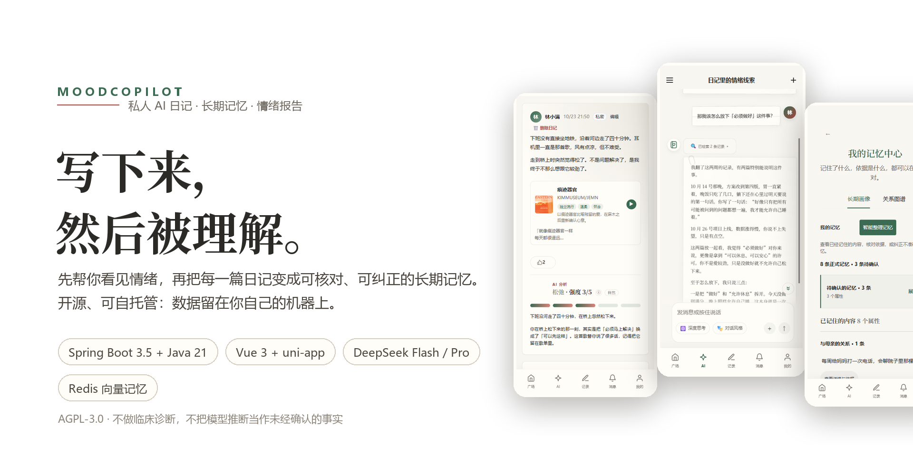
</p>

<p align="center">
  <a href="https://app.moodcopilot.top/">🌐 在线体验（网页版）</a>
  &nbsp;·&nbsp;
  <a href="./docs/小程序码.png">📱 微信小程序</a>
  &nbsp;·&nbsp;
  <a href="#-五分钟跑起来">🚀 自己部署</a>
</p>

---

## 这是什么

MoodCopilot 是一个**可以自己部署的个人 AI 应用**。你写下日记，它读出情绪、整理出关于你的长期记忆，并在聊天时引用这些记忆来回应你。

它不只做情绪陪伴：编程、学习、写作、翻译、规划这些日常任务同样能正常处理。区分在于，MoodCopilot 会把你日积月累的文字变成一份**可核对、可纠正、可追溯**的长期画像，而不是每次对话都从零开始。

**它不做的事**：不做临床诊断，不把模型推断当成未经确认的事实，不因为产品包含情绪功能就把所有话题强行拉回情绪陪伴。

<table>
<tr>
<td width="33%" valign="top">

**📝 写日记**

富文本 / Markdown、图片、网易云音乐、AI 情绪分析

</td>
<td width="33%" valign="top">

**🧠 记得你**

长期记忆分属性管理，证据可回溯，候选需你确认

</td>
<td width="33%" valign="top">

**💬 会引用**

聊天时透明展示「翻到了哪几篇日记」，并可断线续接

</td>
</tr>
</table>

---

## ✨ 功能

### 📝 日记：文字、图片与音乐都是表达

<p align="center">
  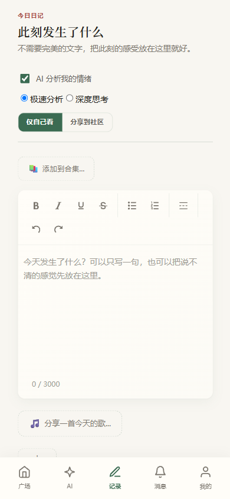
  &nbsp;&nbsp;
  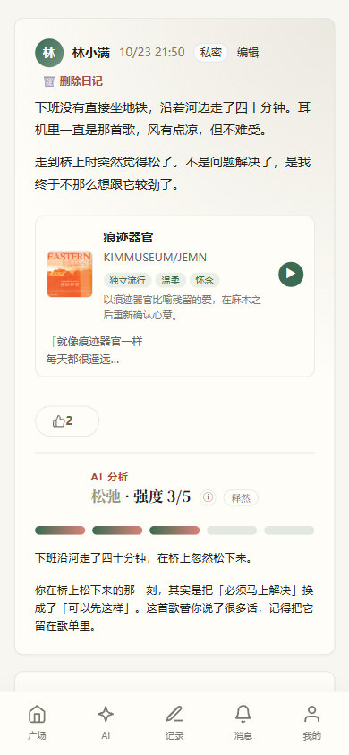
</p>

- **富文本编辑器**（WangEditor）与旧版 Markdown 数据向下兼容，同一篇日记可随时改写。
- **图片参与分析**：单张上限 20MB。视觉模型先描述画面氛围，需要读图上文字时才按需触发 OCR，不会让每张图都白白等一遍识别。
- **网易云音乐解析**：粘贴歌曲链接自动抓取封面、歌词与主题摘要，歌词会与正文一起参与情绪分析。
- **不设固定情绪下拉框**：AI 结合上下文给出最贴切的心境词（例如「怅然若失」「久违的轻盈」），并同时输出效价、唤醒度与强度，用于给页面调色。
- **AI 分析卡片**：情绪标签、强度、主题、摘要与一段回应，只在作者本人可见，公开日记也不例外。
- **合集**：把相关日记归进同一本「专辑」，支持封面裁剪、拖拽排序与公开 / 私密切换，也能从合集里一键起笔。
- **32 套主题**：草木清欢、治愈午后、静谧诗意、梦境童话与 7 套暗色主题；网页与小程序的色板都来自同一份 `shared/theme.ts`。

### 🧠 长期记忆：记住什么、凭什么、能不能改

<p align="center">
  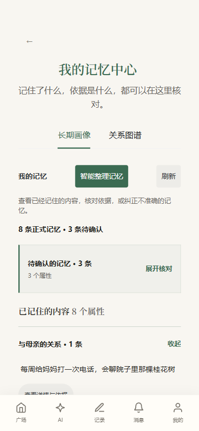
  &nbsp;&nbsp;
  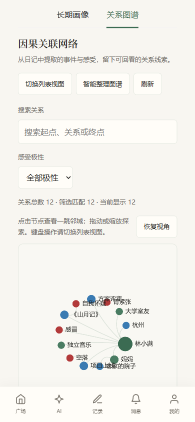
</p>

- **按属性分组**：记忆以「居住城市」「与母亲的关系」「压力信号」这类可读属性组织，可折叠，不再是一长串碎片。
- **候选必须由你确认**：自动抽取只能建立新属性或追加同值证据；已有正式记忆的改写、否定、合并都要你点头，并在聊天里展示改动前后的差异。
- **证据可回溯**：每条记忆都能翻到对应日记中的原文片段；定位不到原文的证据直接丢弃，不会用整篇日记兜底。
- **版本与删除语义清晰**：编辑留下历史版本，删除则彻底清空并按键封印，避免抽取器第二天又把删掉的内容长回来。
- **关系图谱**：从日记中提取「谁—做了什么—带来什么感受」的因果三元组，支持搜索、极性筛选与缩放探索。

### 💬 聊天：透明引用，可中断、可恢复

<p align="center">
  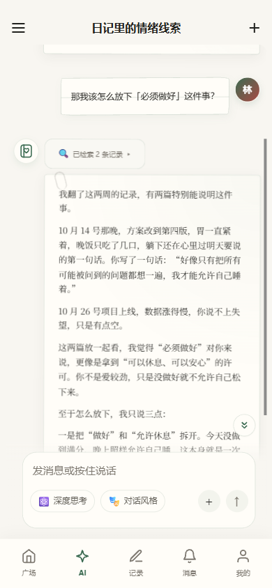
</p>

- **引用可见**：回答前会显示「已检索 N 条记录」，可直接点开看引用了哪几篇日记。
- **可恢复的流式生成**：切页、断线或刷新后按序号续接同一轮生成，已生成的内容不会丢。
- **手动选择模型**：Flash 与 Pro 由你决定（是否开启深度思考），系统不会按问题复杂度自动路由，也不会在额度不足时静默降级。
- **写操作要确认**：会改动你数据的工具在网页端会弹确认框，逐条批准或拒绝；小程序这类无法弹框的通道保持只读，模型会改为提示你到网页端确认。
- **聊天里直接发图**：默认只做画面理解，需要读图上的文字时模型会自己再看一遍。

### 📈 报告与时光画卷：把一段时间放远一点看

<p align="center">
  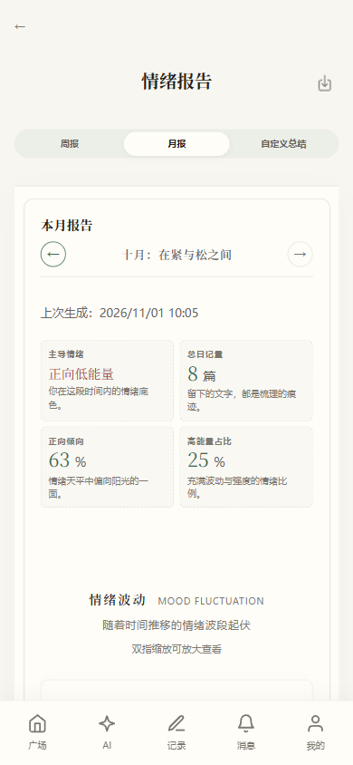
  &nbsp;&nbsp;
  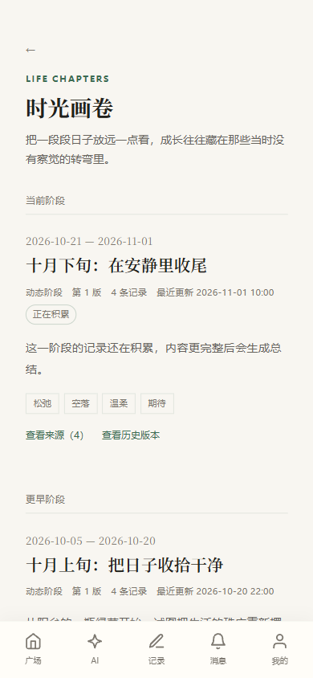
</p>

- **周报 / 月报 / 自定义总结**：情绪波动曲线、情绪四象限分布、主题统计，以及一段由 AI 写的阶段性总结与建议。
- **时光画卷**：按时间自动划分成长章节，沉淀主题、主导情绪与成长反思；章节重新整理有独立配额（每人每天 2 次）。
- **情绪色彩引擎**：效价 × 唤醒度双维双线性插值，在暖黄、草木绿、焦土红褐、暮霭蓝灰四色间取色，再按 15% 与当前主题强调色调和，让情绪只以微光的形式落在纸面上。

### 🧵 重要事件：那些还在心里占着位置的事

<p align="center">
  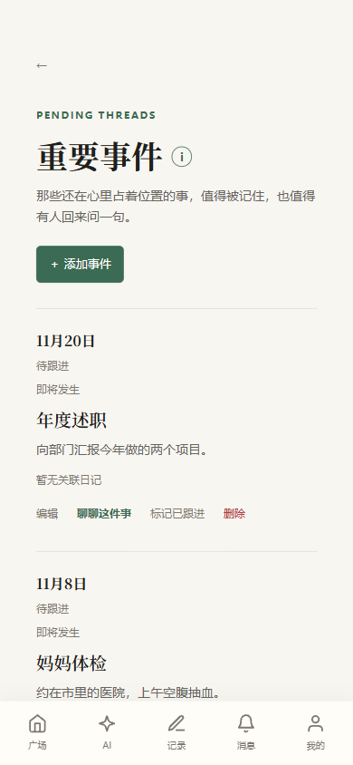
</p>

- 从日记里提取仍在持续的个人事件，支持开始 / 结束日期与可选时间点、手动创建、编辑与日记关联。
- 只有「待跟进」和「已跟进」两种状态，可撤销；聊天入口只注入事件上下文，不会自动改动状态。
- 回访时间按业务时区（默认 `Asia/Shanghai`）解释：只有开始日期按当天 `00:00` 到期，有结束日期无结束时间按 `23:59:59` 到期。

### 🌌 社区与个人主页：只在你想公开的时候

<p align="center">
  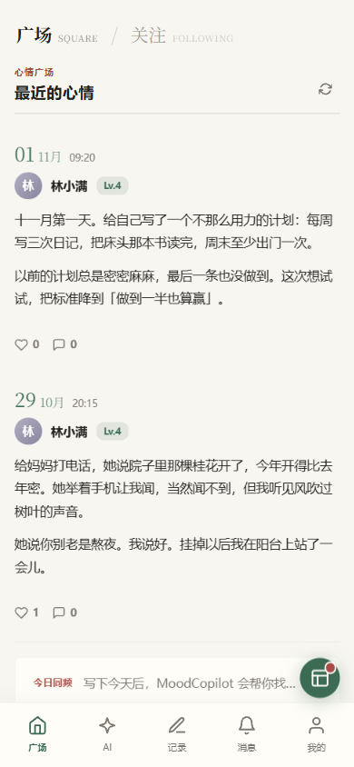
  &nbsp;&nbsp;
  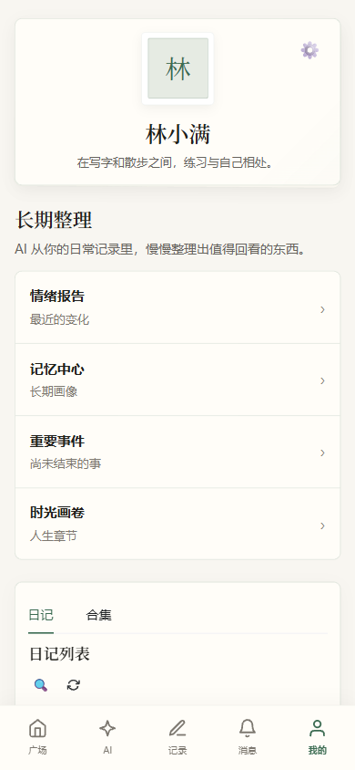
</p>

- 日记默认私密；设为公开后进入广场，与同频的人相遇（今日同频、相似日记推荐）。
- 关注、共鸣、评论、通知中心与举报审核；新消息通过 WebSocket 实时推送，HTTP 轮询兜底，跨页漫游不丢通知。
- **微信小程序定位不同**：只提供日记、AI 陪伴、记忆、报告、合集、成长等私密能力，**不提供**广场、关注、用户主页、评论、点赞、举报等公开社交入口。

---

## 🛠 技术栈

| 模块 | 选型 |
|---|---|
| **后端** | Spring Boot 3.5 · Java 21 · Spring AI · MyBatis-Plus · Flyway |
| **存储** | MySQL 8（事实数据）· Redis Stack（缓存 / 限流 / 聊天历史 / RediSearch HNSW 向量）|
| **异步任务** | RabbitMQ 4（日记分析、记忆抽取、章节整理、通知）· MySQL 任务表承担幂等、租约与重试 |
| **Agent 循环** | LangGraph4j 状态图 + Redis 检查点；同一套循环服务 Flash 与 Pro，差异只在模型参数、预算与是否暴露思考过程 |
| **RAG** | BAAI/bge-m3（1024 维）向量检索 → 资格过滤 → 上下文规划 → 结构化渲染；检索结果只是参考资料，不具备指令权限 |
| **实时通道** | SSE 承载可恢复的聊天生成，WebSocket 承载通知 |
| **前端** | Vue 3.5 · TypeScript · Vite 5 · Naive UI · Tailwind CSS |
| **小程序** | uni-app（Vue 3）+ 自定义 tabBar，与网页共享同一套主题变量与信息层级 |
| **部署** | Docker Compose · Nginx 反代 · Cloudflare Tunnel · GHCR 镜像 + 服务器固定 SHA 发布 |

**归图还是归 MQ**：中途要等人的流程（聊天、工具审批）走状态图；后台一次性、需要重试与死信的任务走 MQ。两套并存，互不调用。

---

## 🚀 五分钟跑起来

### 前置要求

- **Docker**（最省心，用来跑 MySQL 8、Redis Stack、RabbitMQ 4）
- 手动部署时需要的版本：**Java 21**、**Node.js 22+**
- DeepSeek API Key（聊天与日记分析）、SiliconFlow API Key（向量嵌入）；DashScope Key 用于图片理解，可选

### 1. 配置环境变量

```bash
git clone https://github.com/Choco-emmm/MoodCopilot.git
cd MoodCopilot

cp .env.example .env
# 🚨 用编辑器打开 .env，填入数据库密码与各 API Key
```

### 2. 起依赖（MySQL / Redis Stack / RabbitMQ）

```bash
docker compose up -d mysql redis rabbitmq
```

### 3. 起后端与网页

```bash
cd frontend && npm install && cd ..   # 首次需要；后端依赖由 Maven 自动下载
npm run app:start                     # 后端 :18080 + 前端 :4173，并做健康检查
```

打开 <http://127.0.0.1:4173/> 即可。

> `scripts/start-public.ps1` 会先把 `.env` 注入进程环境，再用 `mvn spring-boot:run -Dspring-boot.run.profiles=dev` 启动后端。需要热更新时，把前端换成 `cd frontend && npm run dev`（:5173，Vite 已配好 `/api`、`/ws` 代理）。

也可以手动分两个终端起：

```bash
cd backend/moodcopilot && mvn spring-boot:run -Dspring-boot.run.profiles=dev   # :18080
cd frontend && npm run dev                                                     # :5173
```

### 4. 微信小程序（可选）

```bash
cd frontend-uniapp
npm install
npm run dev:mp-weixin     # 用微信开发者工具导入 dist/dev/mp-weixin
```

AppID 维护在 `frontend-uniapp/src/manifest.json`，不要在开发者工具里临时改，否则下次构建会退回游客项目。小程序默认请求 `https://moodcopilot.top`（由该站点的反向代理访问后端），本地 H5 调试可用 `http://localhost:18080`。

<p>
  
</p>

### 整栈 Docker 部署（服务器）

```bash
cp .env.example .env      # 填好密钥
docker compose up -d --build
```

`docker-compose.yml` 面向服务器场景：`web` 服务在容器内监听 3000，`frontend`（Nginx）对外发布 80/443 并反代 `/api`、`/ws` 与 SSE。若只想在本机看网页版，给 `web` 加上 `3000:3000` 端口映射后访问 <http://localhost:3000>，或直接用上面第 3 步。

生产环境对外域名是 <https://app.moodcopilot.top>（HTTPS + HTTP/2 直连源站，vhost 见 `nginx/conf.d/app.conf`，证书放在服务器的 `nginx/ssl/`）；Cloudflare Tunnel 提供的 <https://moodcopilot.dpdns.org> 保留为备用入口。

### 测试

```bash
# 后端：编译 + 单元测试
cd backend/moodcopilot && mvn --batch-mode clean verify

# 网页：类型检查、构建、浏览器交互回归
cd frontend && npm run build && npm run test:interactions

# 小程序：类型检查 + 单测 + 微信构建
cd frontend-uniapp && npm run type-check && npm test && npm run build:mp-weixin

# 部署脚本自测
bash scripts/tests/deploy-images.test.sh
```

CI 会执行同样的命令（见 `.github/workflows/ci.yml`），分支合并以汇总检查 `CI Ready` 为准。

---

## 📂 项目结构

```text
MoodCopilot/
├── backend/moodcopilot/          # Spring Boot 后端
│   └── src/main/java/com/moodcopilot/
│       ├── ai/                   # Agent 循环、RAG、记忆编排、上下文规划与 Prompt 渲染
│       ├── diary/                # 日记、合集、公开流、同频推荐
│       ├── music/                # 网易云音乐解析
│       ├── event/                # 重要事件与时光画卷
│       ├── graph/                # 知识图谱（因果三元组）
│       ├── summary/ report/      # 周报、月报与自定义总结
│       ├── growth/               # 等级、签到与 AI 配额
│       ├── notification/         # WebSocket 通知
│       ├── admin/                # 举报审核、用户管理、系统公告
│       └── security/ oss/ auth/  # JWT、限流、对象存储、登录注册
├── frontend/                     # 网页端（Vue 3 + TypeScript）
│   ├── src/pages/                # 广场、写日记、详情、聊天、记忆中心、报告、章节、事件、后台…
│   ├── src/components/           # 业务组件
│   └── src/styles.css            # 全局主题 token（颜色只能来自这里）
├── frontend-uniapp/              # 微信小程序（uni-app）
│   └── src/pages/                # 首页、写日记、详情、AI、记忆、报告、合集、成长、设置…
├── shared/theme.ts               # 网页与小程序共享的主题色板
├── docs/                         # 文档、设计稿、截图与验证记录
├── nginx/                        # 反代与 SSE 配置
├── scripts/                      # 本地启动、部署、备份与脚本自测
└── docker-compose.yml
```

---

## 🔒 隐私与数据边界

- **数据留在你自己的机器上**：日记、聊天、记忆、向量索引都在你部署的 MySQL / Redis 里；不接入任何第三方分析 SDK。
- **只出站必要的请求**：调用模型时只发送该任务需要的内容；检索内容是参考资料，不是系统指令。API Key、密码、私钥等敏感信息默认不进入画像、记忆、RAG 与日志。
- **记忆必须可核对**：每条正式记忆都有来源、证据与版本；自动来源不能覆盖已有正式记忆。
- **官方线上服务**：由独立开发者维护，承诺不查看、不分析任何用户的私密日记与聊天记录，也不删档。

---

## 📚 文档

| 文档 | 内容 |
|---|---|
| [记忆写入与审批契约](docs/MEMORY-WRITES.md) | 记忆类型、证据规则、事务恢复与出站脱敏 |
| [聊天事件与 SSE](docs/CHAT-STREAMING.md) | Redis 通知、断线补发、审批续接与独立 Redis 测试 |
| [CI/CD 配置与操作](docs/CI-CD.md) | GitHub Actions、固定 SHA 发布、回滚与服务器配置 |
| [更新记录](docs/CHANGELOG.md) | 版本变更与修复 |
| [验证记录](docs/verification/) | 性能、缺陷修复与发布边界的可复现证据 |
| [路线图](docs/roadmap.md) | 已规划的方向（含语音日记等尚未实现的能力） |

开发约定见 [AGENTS.md](AGENTS.md)：小程序的产品边界、RAG 与 Persona 的强制规范、全局主题颜色规则都写在那里。

---

## 🤝 参与贡献

MoodCopilot 仍在快速迭代，一个人的产能有限，你的 Issue 和 PR 都很重要。

1. Fork 本仓库并 `git clone` 到本地
2. 新建分支：`git checkout -b feat/amazing-feature`
3. 提交：`git commit -m 'feat: 增加某个能力'`
4. 推送并创建 Pull Request，附上改动说明与验证方式

- **QQ 交流群**：1094722984
  <br />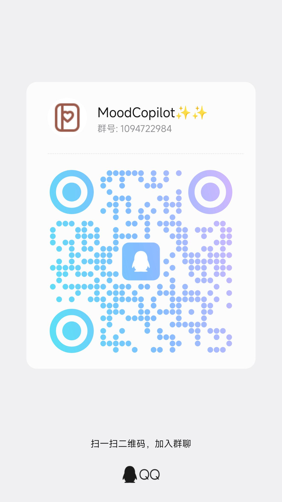
- **想做的方向**：语音日记、RAG 召回质量、记忆编辑体验、小程序交互、主题设计——都欢迎。

提交前请确保 `git diff --check` 干净，并跑通上面「测试」一节的命令。

---

## 📄 开源协议

本项目基于 [AGPL-3.0](LICENSE) 许可：任何基于此代码提供的网络服务都必须同样开源。

<p align="center">
  <sub>Made with ❤️ by 自由基 &amp; MoodCopilot AI</sub>
</p>
