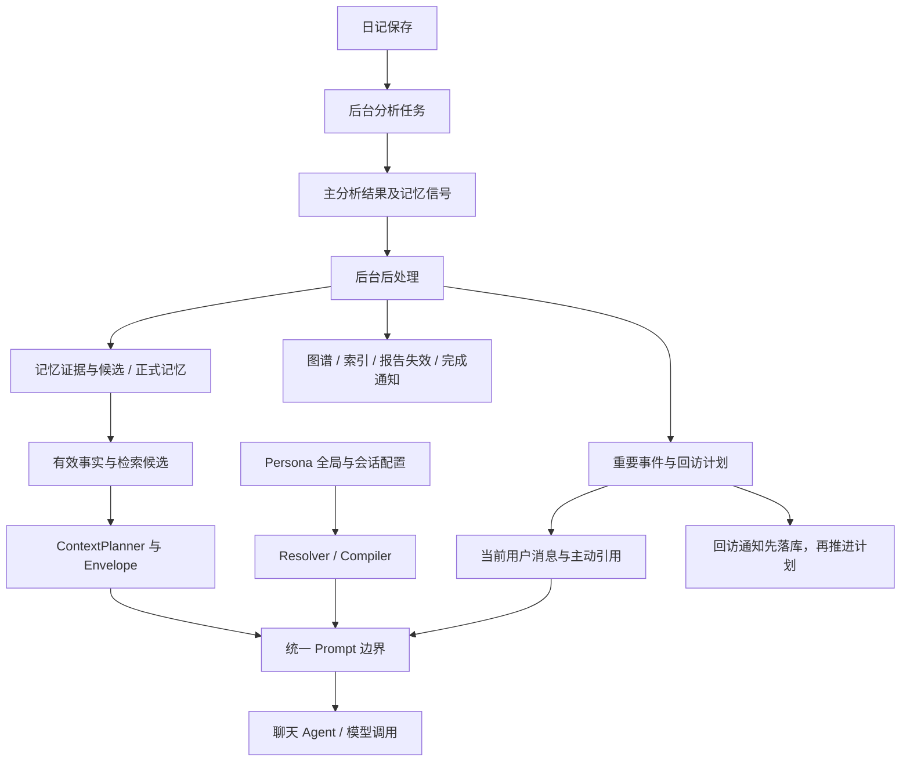

# MoodCopilot 代码复盘路线

更新日期：2026-11-16（Asia/Shanghai）。这些材料用于打开源码逐步跟踪，不作为本人已经独立掌握或功能已经实测通过的证明。

## 先从哪里读

| 顺序 | 材料 | 跟踪的问题 | 读完应能解释 |
| --- | --- | --- | --- |
| 1 | [一条日记](./diary-code-path.md) | 从点保存到分析结果出现 | 请求、事务、异步、状态、旧结果校验 |
| 2 | [一条后台任务](./task-code-path.md) | 从任务入库到消费和重试 | 发布确认、ACK、条件 UPDATE、租约、幂等边界 |
| 3 | [一条记忆](./memory-code-path.md) | 从用户原文到候选、正式版本和删除 | 证据、用户确认、版本链、封印、索引 |
| 4 | [一次检索与上下文](./rag-context-code-path.md) | 从查询文本到模型可见资料 | 查询来源、embedding、兜底、资格、规划、渲染 |
| 5 | [一份 Persona 设置](./persona-code-path.md) | 从保存设置到聊天实际生效 | 两层作用域、空值、版本、安全、预览隔离 |
| 6 | [一条重要事件与回访](./event-code-path.md) | 从事件创建到通知与聊天引用 | 业务时区、状态、原子闸门、先落库后推进 |
| 7 | [一条聊天消息（既有材料）](./message-code-path.md) | 从发送到 Agent、审批、刷新和历史 | 会话／run／context 三种 ID，图与传输的边界 |

先读日记是因为它能把熟悉的 Controller → Service → Mapper 与异步任务串起来；再读任务和记忆，最后回头读聊天更容易分清职责。已经熟悉聊天时，可以从消息篇转入记忆和 RAG。

六篇新材料按当前工作区走读，包含用户尚未提交的代码；仅 HEAD 不能重建完整内容。旧消息篇仍保留其 `933ff4a...` 基线与 2026-10-28 验证记录，它的日记附录不能替代新日记／任务篇。不要把新文档的日期、旧材料的测试结果和当前工作区拼成同一次验证。

## 这些链路怎样接起来



图表示模块之间的关系，不表示每次请求都会经过每个节点。日记分析自身也会使用上下文；聊天后的记忆抽取还存在 `aiExecutor` 路径，不能看图就说所有抽取都已经走 MQ。

## 每一篇怎么读才算完成

一轮只跟一个虚构例子，例如“下班后散步”。不要刚进 Service 就跳去读整个类的所有方法。

1. **先看输入。** 找 Controller 参数或前端 payload，写清字段类型，区分请求值、认证值、数据库值。
2. **跟主线。** 沿表格打开代码，记录每步输入／输出、同步或异步、是否写库。调用者和被调用者都要看。
3. **读关键分支。** 找权限、状态、事务、锁、版本与异常。对普通辅助方法先用一句话概括，对这些分支逐段解释。
4. **跟一个失败例子。** 模型超时、用户中途编辑、重复消息、通知落库失败，各挑一个。说清谁捕获、状态写哪里、谁发起重试。
5. **看一份相关测试。** 先读 arrange / act / assert，说明模拟了什么、没有模拟什么；“仓库有测试”不能写成“我刚跑过”。
6. **合上文档复述。** 用文末 60 秒回答讲一次，再自己画流程图；卡住的地方回源码，而不是只背答案。

遇到嵌套表达式时，把它拆开。例如之前读的事件引用：

```java
String idText = String.valueOf(eventIdObj);        // Object → 字符串
long eventId = Long.parseLong(idText);             // 字符串 → long
referenceRequests = appendEventReference(referenceRequests, eventId);
// 复制原引用列表、追加事件，再让变量接住新列表
```

先看清语法和实际返回值，再问“为什么需要复制、为什么统一引用、权限在哪里校验”。这三个问题分别属于语言、接口设计与安全边界，不必一次混在一起理解。

## 给自己的走读记录

每读完一篇复制下面的记录填写，不预先勾成已完成：

```text
链路：
实际阅读日期 / 当前 HEAD / 是否包含未提交修改：
虚构输入：
入口与最终输出：
我能解释的关键方法（3–5 个）：
涉及的表、缓存键、状态：
一次写入的事务边界：
一个失败分支与恢复方式：
一个并发／幂等边界：
实际运行的测试或演练及结果（没有就写未执行）：
目前还不能解释的代码：
```

验收不是记住行号，而是给出一个现象时，能找到入口、沿数据变化定位、提出验证办法，并说清目前无法保证的部分。

## 本轮校验与后续维护

本轮只新增文档并更新导航，核对代码入口、行号、文档链接和差异空白；未重新编译业务项目、执行后端测试或真实模型／浏览器／微信端闭环。各篇测试入口是下一步练习材料。

代码链接按整理时的本机绝对路径和行号生成；代码移动后先按方法名搜索，不要把旧行号视为永久保证：

```powershell
rg -n 'runAiAnalysisSync|writeCurrentAnalysis' backend/moodcopilot/src/main/java
rg -n 'processExtractedMemories|approveCandidate|saveFormal' backend/moodcopilot/src/main/java
rg -n 'claimForRun|markFailed|recoverExpiredTasks' backend/moodcopilot/src/main/java
git diff --check -- docs/interview
```

这些篇目覆盖核心个人 AI 链路；图谱、章节、报告和部署的独立完整生命周期暂未另成篇，不应把它们视为已经完成走读。
