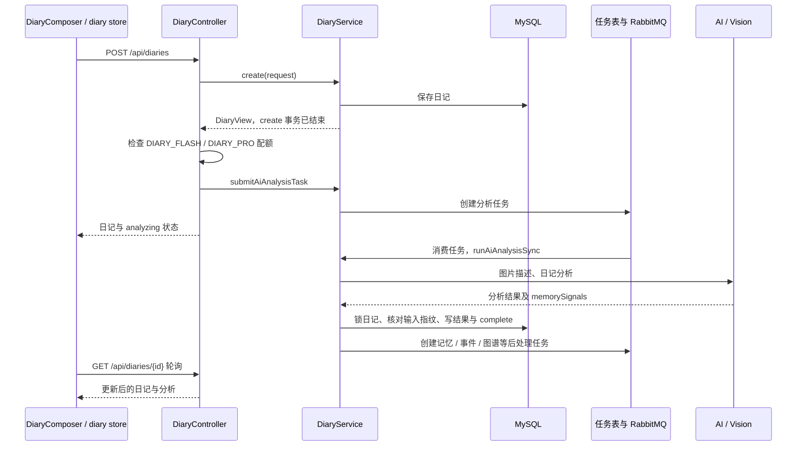

# 一条日记的完整代码路径

整理日期：2026-11-16（Asia/Shanghai）。按当前工作区源码走读，包含尚未提交的修改；HEAD 为 `3d895f82a2c9af3d4e1e34b5f573708092f2a765`，不代表纯提交快照。本篇未调用真实 AI、MQ 或数据库，测试名称仅作为阅读入口。

主线：用户在 Web 写下“最近下班后会散步”，打开 AI 分析，手动选择 Flash，然后保存。先读业务流程，再接着读[一条后台任务](./task-code-path.md)和[一条记忆](./memory-code-path.md)。

## 先认清这些数据

| 名称 | 表示什么 | 不要混淆 |
| --- | --- | --- |
| `diaryId` | 一篇日记的 ID | 不是一次分析任务的 ID |
| `analyze` | 用户是否要求分析 | `false` 不等于 Flash |
| `useReasoning` | 用户选择 Flash / Pro | `false` 为 Flash，`true` 为 Pro，不自动路由 |
| `taskId` | 某个后台任务的 ID | 同一篇日记可以产生主任务和多个子任务 |
| `inputVersion` | `DiaryAnalysisInput.fingerprint` 算出的用户输入指纹 | 包括正文、图片及部分音乐字段，不只是正文 |
| 后处理的 `analysisVersion` | 当前实现按正文计算的 MD5 | 与上面的输入指纹不是同一个口径，不能宣称覆盖全部附件变化 |

## 从保存到分析完成

图省略了 `create` 中的成长、报告缓存和日记索引调用；它不是纯粹的一次 INSERT。通知分支也不等于浏览器一定已经接收消息。

| 顺序 | 代码入口 | 这一段要看懂什么 |
| --- | --- | --- |
| 1 | [DiaryComposer.handleSave][composer] | 组装正文、可见性、图片、音乐、`analyze` 和 `useReasoning`；新建与编辑走不同 store 方法。 |
| 2 | [diary store.createDiary][store]、[diaryApi.create][api] | 请求后先处理“日记保存成功”，再按服务端配额／关闭状态决定是否等待分析；不能把 HTTP 成功当成 AI 已完成。 |
| 3 | [DiaryController.create][controller] | 先调用 `create` 保存，再检查配额。额度不足保留日记，返回 Flash 的 `skipped_quota` 或 Pro 的 `failed_limit`。 |
| 4 | [DiaryService.create][create] | 从认证上下文取得作者，规范正文与附件；`@Transactional` 保存日记，关闭分析时持久化 `skipped_user`。 |
| 5 | [submitAiAnalysisTask][submit] | 写 `analyzing`、请求模型，取消旧的待执行任务，然后入任务表；提交异常时写 `failed` 后重新抛出。 |
| 6 | [AiTaskProducer.submitDiaryAnalysisTask][producer] | 读取当前日记，计算输入指纹，建立含请求 UUID 的 operationKey。用户再次提交与 MQ 重投不是同一个动作。 |
| 7 | [AiTaskConsumer.consume][consumer] | 先领取任务执行资格，再进入业务方法；成功／失败状态落库后 ACK。投递与重试细节见任务篇。 |
| 8 | [runAiAnalysisSync][run] | 复核日记存在、作者、删除和关闭状态，记录开始时输入指纹；补音乐信息，生成图片描述，再调用分析。模型调用不包在长数据库事务里。 |
| 9 | [AiAnalysisService.analyzeWithMemorySignals][analysis] | 检索历史候选，规划上下文，按用户指定模型分析；主分析同时返回可选记忆信号，避免后续一定再调用一次抽取模型。 |
| 10 | [writeCurrentAnalysis][guard] | 使用日记行锁再次确认未删除、未关闭、输入仍一致，再写分析结果及 `complete`；期间修改过正文或附件就丢弃旧结果。 |
| 11 | [submitAnalysisPostProcessTasks][post]、[AiPostProcessService.process][process] | 创建记忆、事件、图谱、日记索引、报告失效、完成通知六类子任务，各自执行；主分析完成不等于它们全部完成。 |
| 12 | [pollAnalysis][poll] | Web 当前通过有上限的轮询重新读取日记、更新分析；小程序的推送处理另在 [socket.ts][mp-socket]，不能把两端描述成相同机制。 |

## 状态要分三层

| 层次 | 例子 | 含义 |
| --- | --- | --- |
| 日记分析状态 | `analyzing / complete / failed / skipped_user` | 服务端日记上的分析状态 |
| 创建接口返回状态 | `skipped_quota / failed_limit` | 创建时 Controller 用 `withAnalysisStatus` 返回配额结果；这一分支未直接写回日记状态，不能假设刷新仍读取到相同值 |
| 任务状态 | `PENDING_DISPATCH / PUBLISHED / RUNNING / RETRY_WAIT / SUCCEEDED / DEAD_LETTER / CANCELLED` | 后台任务执行进度，不能直接拿来当日记状态 |

前端 store 还有自己的 UI 状态；它是展示状态，不是第四份业务权威。`complete` 的拼写也不要写成 `completed`。

## 编辑、关闭、失败和删除

- **分析中关闭分析：** [updateDiary][update] 在日记行锁与事务内写 `skipped_user`、删除旧分析、取消待执行任务。已运行任务仍可能完成模型调用，但落库前的指纹与关闭校验会挡住旧结果。取消任务不等于取消外部 HTTP 调用。
- **修改后重新分析：** 比较正文、音乐、图片等输入，额度允许后清理旧结果并提交新任务；[retryAnalysis][retry] 是显式重试入口，也检查作者与配额。
- **提交失败：** 日记创建事务已经结束，任务入库失败可能使接口报错而日记仍然存在；不是日记和任务原子提交的完整 Outbox。
- **分析失败：** 当前输入仍有效时先写日记 `failed`，再抛给消费者安排重试。写结果后的子任务创建也在同一个外层 try 中，因此后处理提交异常仍可能让主分析进入失败重试；不能说“写完结果后后续异常绝不影响主任务”。
- **旧任务边界：** `inputVersion` 检查解决本轮执行期间输入变化；后处理正文 MD5 并不是所有来源的完整版本隔离。不要从字段名推导出“所有旧任务都会被拦住”。
- **删除：** [deleteDiary][delete] 检查作者／管理员权限，通过 Mapper 删除日记（实体带 `@TableLogic`），清合集关联、图谱、向量和图片，并通知章节来源变化。日记删除与正式记忆按键清除不是同一个操作。

## 建议下断点和复盘

先在 `DiaryController.create` 看 `request`；再在 `submitAiAnalysisTask` 看 `diaryId` 与模型；最后在 `writeCurrentAnalysis` 比较 `inputVersion` 与当前指纹。观察 ID、状态、布尔值和长度即可，勿把私人正文复制到日志。

- [ ] 能说明“日记已保存，但 AI 没完成”为什么是合法状态。
- [ ] 能找到日记事务结束的位置，以及模型调用为什么放在事务外。
- [ ] 能用代码解释关闭分析如何阻止旧结果写回。
- [ ] 能区分主分析完成、记忆写入完成、Web 页面更新。
- [ ] 能说出 `inputVersion` 与后处理 `analysisVersion` 的差别。

推荐读 [DiaryAnalysisOptOutTest][test-opt]、[DiaryTaskInputTest][test-input]；本篇未执行这些测试。练习时用虚构日记验证正常保存、关闭分析和编辑竞争，不操作真实用户数据。

## 60 秒复述

> 网页把日记和分析选择传到 Controller，服务端先保存日记，再检查用户选定模型的配额并创建后台任务。消费者领取任务后生成图片描述与分析结果，落库时用行锁和输入指纹确认日记没有被关闭或改动。主分析完成后再安排记忆、事件、图谱等后处理，网页通过重新读取日记更新状态。保存、分析和后处理有不同的失败边界，任务重试也不等于外部模型严格只调用一次。

[composer]: D:/Code/MoodCopilot/frontend/src/components/DiaryComposer.vue:650
[store]: D:/Code/MoodCopilot/frontend/src/stores/diary.ts:165
[api]: D:/Code/MoodCopilot/frontend/src/api/diary.ts:17
[controller]: D:/Code/MoodCopilot/backend/moodcopilot/src/main/java/com/moodcopilot/diary/DiaryController.java:40
[create]: D:/Code/MoodCopilot/backend/moodcopilot/src/main/java/com/moodcopilot/diary/DiaryService.java:188
[submit]: D:/Code/MoodCopilot/backend/moodcopilot/src/main/java/com/moodcopilot/diary/DiaryService.java:372
[producer]: D:/Code/MoodCopilot/backend/moodcopilot/src/main/java/com/moodcopilot/ai/mq/AiTaskProducer.java:25
[consumer]: D:/Code/MoodCopilot/backend/moodcopilot/src/main/java/com/moodcopilot/ai/mq/AiTaskConsumer.java:69
[run]: D:/Code/MoodCopilot/backend/moodcopilot/src/main/java/com/moodcopilot/diary/DiaryService.java:430
[analysis]: D:/Code/MoodCopilot/backend/moodcopilot/src/main/java/com/moodcopilot/ai/AiAnalysisService.java:147
[guard]: D:/Code/MoodCopilot/backend/moodcopilot/src/main/java/com/moodcopilot/diary/DiaryService.java:583
[post]: D:/Code/MoodCopilot/backend/moodcopilot/src/main/java/com/moodcopilot/ai/mq/AiTaskProducer.java:46
[process]: D:/Code/MoodCopilot/backend/moodcopilot/src/main/java/com/moodcopilot/ai/AiPostProcessService.java:79
[poll]: D:/Code/MoodCopilot/frontend/src/stores/diary.ts:254
[mp-socket]: D:/Code/MoodCopilot/frontend-uniapp/src/utils/socket.ts:102
[update]: D:/Code/MoodCopilot/backend/moodcopilot/src/main/java/com/moodcopilot/diary/DiaryService.java:231
[retry]: D:/Code/MoodCopilot/backend/moodcopilot/src/main/java/com/moodcopilot/diary/DiaryService.java:395
[delete]: D:/Code/MoodCopilot/backend/moodcopilot/src/main/java/com/moodcopilot/diary/DiaryService.java:1944
[test-opt]: D:/Code/MoodCopilot/backend/moodcopilot/src/test/java/com/moodcopilot/diary/DiaryAnalysisOptOutTest.java:40
[test-input]: D:/Code/MoodCopilot/backend/moodcopilot/src/test/java/com/moodcopilot/ai/mq/DiaryTaskInputTest.java:12
