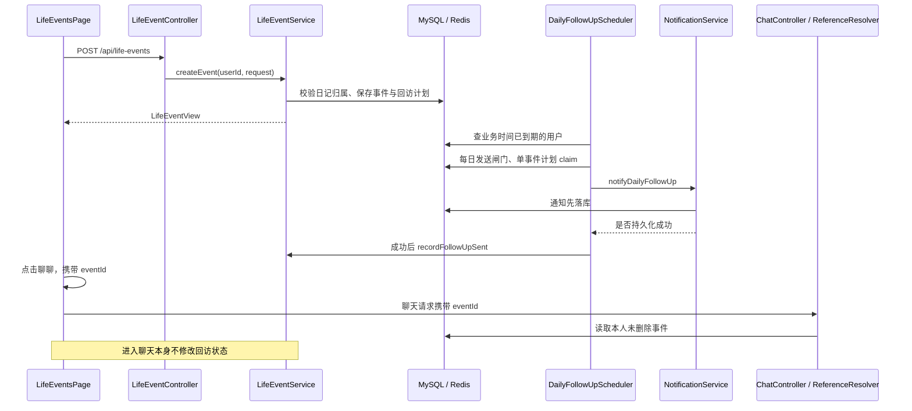

# 一条重要事件与回访的完整代码路径

整理日期：2026-11-16（Asia/Shanghai）。依据当前工作区（含未提交修改），HEAD 为 `3d895f82a2c9af3d4e1e34b5f573708092f2a765`。本篇未执行定时任务、发送通知或修改事件。

主线：用户创建“周五面试”的私密事件，系统安排回访；用户从事件进入聊天，再主动更新跟进状态。附日记自动提取事件的入口。事件和日记、正式记忆是不同对象，即使记忆类型也有 `event`，也不能把两种存储混为一谈。

## 状态和时间先分清

| 字段 | 含义 |
| --- | --- |
| `status` | 回访状态：`PENDING / FOLLOWED_UP`；历史 `ARCHIVED` 兼容显示为已跟进 |
| `temporalPhase` | 时间阶段：`UPCOMING / ONGOING / PAST`，不是回访状态 |
| `targetDate / endDate / startTime / endTime` | 业务时区里的本地日期和时间，不由浏览器时区改写 |
| `nextFollowUpAt` | 下一次计划回访时间，调度查询使用它；不必等于事件结束时间 |
| `followUpCompleted / followUpCount` | 自动回访计划是否完成，以及发送计数 |
| `deletedAt` | 软删除标记；删除后不再参与普通读取与回访 |

业务时区来自 `moodcopilot.time-zone`，默认 `Asia/Shanghai`。`PAST + PENDING` 是合法组合，表示事情已经发生、还需要跟进。

## 创建、调度、聊天的主线

WebSocket 是通知落库后的推送，推送成功不是推进计划的前提。

| 顺序 | 代码入口 | 需要看懂的行为 |
| --- | --- | --- |
| 1 | [LifeEventsPage][page]、[lifeEventApi][api] | 表单收集本地日期／时间、重要程度与关联日记，创建／编辑走明确接口。 |
| 2 | [LifeEventController.createEvent][controller] | userId 来自认证用户，不能由客户端指定任意用户。 |
| 3 | [LifeEventService.createEvent][create]、[parseSchedule][parse] | 校验日期顺序和时间，验证所关联日记属于当前用户；保存事件，计算阶段和回访计划，并通知时间线来源变化。 |
| 4 | [applyTemporalAndFollowUp][plan]、[dueAt][due] | 事件时刻、阶段和回访时间是相关但不同的概念；规则要读本地时间计算，不能套机器默认时区。 |
| 5 | [DailyFollowUpScheduler.sendDailyFollowUp][schedule] | 当前每小时扫描已到回访时间的用户；业务当前时间显式使用配置时区。普通每日陪伴分支目前停用，不要说仍在每天给所有人发送。 |
| 6 | [claimDailySend][daily-claim]、[claimFollowUp][event-claim] | 每用户每业务日的 Redis 原子闸门，再加事件计划 claim；不同作用域的去重不能互相替代。 |
| 7 | [NotificationService.notifyDailyFollowUp][notify] | 先 INSERT 通知；落库失败返回 false。落库成功后尝试 WebSocket，即使推送失败也返回成功，用户仍可从列表读取。 |
| 8 | [recordFollowUpSent][record] | 再检查事件归属、PENDING 与本次计划时间，只有通知已保存才推进计数／计划。达到自动回访上限时可结束计划并设为已跟进，不是每次发送都立刻已跟进。 |
| 9 | [LifeEventsPage.chatAbout][chat] → [ChatController.startRun][chat-controller] → [ChatReferenceResolver.resolveEvent][resolver] | 前端携带 eventId，后端统一成事件引用、读取本人未删除事件。只注入聊天背景，不因为点击就改变事件状态。 |
| 10 | [updateEventStatus][status]、[markEventFollowedUp][followed] | 用户显式更新跟进状态，单独走事件接口；时间过去不等于已经跟进。 |

## 日期规则要能举例解释

在业务时区下，假设开始日期为 11 月 20 日：

| 输入 | `dueAt` 对应的事件到期时刻 |
| --- | --- |
| 只有开始日期 | 11 月 20 日 00:00 |
| 开始日期与开始时间 09:00 | 11 月 20 日 09:00 |
| 有结束日期 11 月 22 日，但无结束时间 | 11 月 22 日 23:59:59.999999999 |
| 有结束日期 11 月 22 日与结束时间 17:00 | 11 月 22 日 17:00 |

`nextFollowUpAt` 还受回访建议和计划规则影响，不要拿上表替代全部调度逻辑。`temporalPhase` 也按日期／时间计算，并不读取“是否跟进”来决定过去未来。

## 另外两条入口：自动提取与删除

**日记提取：** 日记分析后 `LIFE_EVENT_EXTRACTION` → [AiPostProcessService.process][post] → [extractAndTrackLifeEvents][extract]。模型提出事件，服务端解析并合并当前用户事件。已有已跟进事件不能因自动提取而重新打开；提取结果不是随意改状态的授权。这个后台入口归 MQ，不在聊天 Agent 图里再执行一次。

**删除：** [softDeleteEvent][delete] 保留行但写 deletedAt、清回访计划、标记计划完成，并调用章节服务处理来源变化。[ChatReferenceResolver][resolver] 也检查 deletedAt。不能只让事件列表隐藏，聊天引用和时间线仍读出旧内容。需要追踪章节／索引的进一步清理时，从 `LifeChapterService.onEventDeleted` 继续走。

## 失败与并发分支

- **通知未落库：** 释放事件 claim；每日闸门在未持久化时也释放，使后续可以重试。
- **WebSocket 推送失败：** 通知已经落库，仍视为成功；不能因此无限重发同一通知。
- **发送中用户改了计划或完成跟进：** `recordFollowUpSent` 对比旧 scheduledAt 和当前状态，不应推进已经变化的计划。
- **Redis 闸门失败：** 当前生产路径选择暂不发送，避免没有去重能力时重复推送；不是绕过闸门继续执行。
- **一致性边界：** Redis claim、通知 INSERT 和计划更新并非一个跨系统事务。应分别检查窗口，不能仅凭有锁就宣称任意崩溃下严格一次。

## 断点与复盘问题

断点依次放在 `createEvent`、`dueAt`、`claimDailySend`、`notifyDailyFollowUp` 和 `recordFollowUpSent`；观察本地时间、计划时间、状态、是否已保存。用固定测试时钟／虚构事件阅读边界，勿为了演练运行真实用户的定时推送。

- [ ] 为什么“过去的事件”仍可能需要跟进？
- [ ] 为什么 notificationPersisted 与 WebSocket 发送成功不能共用一个布尔值？
- [ ] 每日用户闸门与单事件计划 claim 各自挡住什么？
- [ ] 为什么进入事件聊天不应该调用标记已跟进接口？
- [ ] 只有开始日期与有结束日期的到期边界为何不同？
- [ ] 删除后需要检查哪些读路径，为什么仅隐藏列表不够？

推荐读 [LifeEventServiceTest][test-event]、[NotificationServiceTest][test-notification]；本篇未运行测试。

## 60 秒复述

> 事件独立保存回访状态、时间阶段和业务时区下的本地日期时间。创建时验证关联日记归属并计算计划，定时任务按业务时间找出到期用户，通过 Redis 每日闸门和事件 claim 防竞争。通知先落库，成功后才推进计划，推送失败不撤销已经保存的通知。进入聊天只传事件上下文，用户跟进走独立接口；删除采用软删除，并让引用与时间线来源同步失效。

[page]: D:/Code/MoodCopilot/frontend/src/pages/LifeEventsPage.vue:175
[api]: D:/Code/MoodCopilot/frontend/src/api/life.ts:62
[controller]: D:/Code/MoodCopilot/backend/moodcopilot/src/main/java/com/moodcopilot/event/LifeEventController.java:48
[create]: D:/Code/MoodCopilot/backend/moodcopilot/src/main/java/com/moodcopilot/event/LifeEventService.java:254
[parse]: D:/Code/MoodCopilot/backend/moodcopilot/src/main/java/com/moodcopilot/event/LifeEventService.java:702
[plan]: D:/Code/MoodCopilot/backend/moodcopilot/src/main/java/com/moodcopilot/event/LifeEventService.java:767
[due]: D:/Code/MoodCopilot/backend/moodcopilot/src/main/java/com/moodcopilot/event/LifeEventService.java:896
[schedule]: D:/Code/MoodCopilot/backend/moodcopilot/src/main/java/com/moodcopilot/ai/DailyFollowUpScheduler.java:79
[daily-claim]: D:/Code/MoodCopilot/backend/moodcopilot/src/main/java/com/moodcopilot/ai/DailyFollowUpScheduler.java:143
[event-claim]: D:/Code/MoodCopilot/backend/moodcopilot/src/main/java/com/moodcopilot/event/LifeEventService.java:472
[notify]: D:/Code/MoodCopilot/backend/moodcopilot/src/main/java/com/moodcopilot/notification/NotificationService.java:158
[record]: D:/Code/MoodCopilot/backend/moodcopilot/src/main/java/com/moodcopilot/event/LifeEventService.java:495
[chat]: D:/Code/MoodCopilot/frontend/src/pages/LifeEventsPage.vue:198
[chat-controller]: D:/Code/MoodCopilot/backend/moodcopilot/src/main/java/com/moodcopilot/ai/ChatController.java:74
[resolver]: D:/Code/MoodCopilot/backend/moodcopilot/src/main/java/com/moodcopilot/ai/ChatReferenceResolver.java:69
[status]: D:/Code/MoodCopilot/backend/moodcopilot/src/main/java/com/moodcopilot/event/LifeEventService.java:424
[followed]: D:/Code/MoodCopilot/backend/moodcopilot/src/main/java/com/moodcopilot/event/LifeEventService.java:556
[post]: D:/Code/MoodCopilot/backend/moodcopilot/src/main/java/com/moodcopilot/ai/AiPostProcessService.java:79
[extract]: D:/Code/MoodCopilot/backend/moodcopilot/src/main/java/com/moodcopilot/event/LifeEventService.java:152
[delete]: D:/Code/MoodCopilot/backend/moodcopilot/src/main/java/com/moodcopilot/event/LifeEventService.java:447
[test-event]: D:/Code/MoodCopilot/backend/moodcopilot/src/test/java/com/moodcopilot/event/LifeEventServiceTest.java:28
[test-notification]: D:/Code/MoodCopilot/backend/moodcopilot/src/test/java/com/moodcopilot/notification/NotificationServiceTest.java:14
