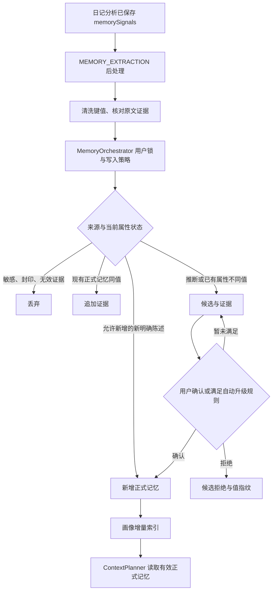

# 一条记忆的完整代码路径

整理日期：2026-11-16（Asia/Shanghai）。依据当前工作区，包含未提交修改；HEAD 为 `3d895f82a2c9af3d4e1e34b5f573708092f2a765`。这是源码走读，未执行真实抽取、审批或数据库操作。写入规则另见 [MEMORY-WRITES.md](../MEMORY-WRITES.md)。

主线：某篇日记主分析给出“运动习惯＝下班后散步”的推断信号，证据为用户原文“最近下班后会散步”。假设它未满足直接新增正式记忆的条件，先成为候选，再由用户确认。模型生成的具体键值不是固定结果，例子只用于追踪数据。

## 一条事实为什么不止一张表

| 数据 | 用途 | 主要标识 |
| --- | --- | --- |
| `UserProfileMemoryEntity` | 正式记忆及历史版本 | `memoryId`、`status`、`previousMemoryId` |
| `UserMemoryCandidateEntity` | 待确认的事实分支 | `candidateId`、`PENDING / APPROVED / REJECTED / MERGED` |
| `UserMemoryEvidenceEntity` | 原文证据及来源 | `memoryId / candidateId`、日记／会话 ID、证据日期 |
| `UserMemoryRejectionEntity` | 拒绝值指纹或删除键封印 | 归一化键、值指纹、拒绝类型 |
| `MemoryChangeCommandEntity` | 聊天修改工具的持久化回执 | `userId + runId + toolCallId` |

属性键是“运动习惯”这类数据库原值，前端不另做翻译映射。候选 ID、正式 ID、来源日记 ID 属于不同对象，不能互换。

## 从分析信号到正式记忆



“满足自动升级规则”只允许没有有效正式值的新属性，不能自动覆盖已有正式记忆。不能把这张图读成“所有候选都必须手动确认”或“模型标 explicit 就能改旧值”。

| 顺序 | 入口 | 要看懂的行为 |
| --- | --- | --- |
| 1 | [AiPostProcessService.process][post] | `MEMORY_EXTRACTION` 读取归属正确且未删除的日记，调用日记记忆抽取，完成后提交 `MEMORY_RAG_INDEX`。 |
| 2 | [extractAndSyncMemoryForDiary][extract] | 有已保存的 `memorySignalsJson` 就复用主分析信号；只有缺少信号时进入兼容模型抽取流程。空信号列表与“没有信号字段”也要区分。 |
| 3 | [sanitizeAttributes][sanitize]、[retainUserGroundedAttributes][ground] | 清洗类型、键值和敏感信息；证据必须能在用户正文／主动歌词中找到短连续片段，不能用 AI 反馈或图片描述作事实证据。 |
| 4 | [processExtractedMemories][orchestrator] | 加用户行锁；执行共同写入策略，检查证据、拒绝指纹、删除封印和已有值，再决定追加证据、候选或正式写入。 |
| 5 | [maybePromote][promote] | 看独立日期数、证据质量、模型置信度、衰减等规则。置信度高并不自动授予覆盖权限；已有正式属性时不自动升级替换。 |
| 6 | [memoryApi][api]、[UserProfileMemoryController.candidates][candidates] | 前端读取候选及证据。列表展示、详情与依据是不同读取入口；候选不会因为显示出来就成为聊天事实。 |
| 7 | [approveCandidate][approve] / [rejectCandidate][reject] | 用户确认可以带编辑值；确认在事务内写正式记忆、关联证据并更新候选。重复同向操作可幂等，相反的已处理状态返回冲突。 |
| 8 | [saveFormal][formal] | 已有值被用户改写时旧行 `superseded`，新行 `active`，新行的 `previousMemoryId` 指向旧行；同值通常复用正式行。 |
| 9 | [reindex][index]、[indexUserProfile][rag] | 用户操作在事务提交后同步索引；日记自动抽取通过专门 RAG 子任务索引。向量是检索副本，不是正式事实权威。 |
| 10 | [ContextPlanner][planner] | 只让属于当前用户、状态和有效期合规的正式记忆进入上下文；候选、被替代版本和拒绝记录不能当普通事实注入。 |

## 重点细读：同一个信号可能有四种结果

```text
用户原文中的明确新陈述 + 证据通过 + 不触发拒绝/封印
    → 在服务端规则允许时新增正式记忆
已有“运动习惯＝下班后散步” + 同值新证据
    → 追加证据，不新造一个不同事实
已有“运动习惯＝跑步” + 自动提取“运动习惯＝散步”
    → 候选分支，等待用户决定，不能静默覆盖
属性被用户彻底删除并封印 + 再次自动提取
    → 拦截；模型标 explicit 也不能绕过封印
```

`assertionType=explicit` 是模型对表达方式的判断。只有服务端识别的用户确认入口，才具有相应写入授权。

候选去重依据 `userId + attributeKey + memoryType + normalizedValue` 的确定性指纹；“散步”和“喜欢散步”不能仅凭包含关系自动合并。读 [MemoryCandidateMergePolicy][merge-policy] 时注意 `C++` 与 `C#` 的符号不能被抹掉。

## 编辑、删除与聊天写入是不同分支

- **记忆中心编辑：** `PUT /api/memory/{id}` → [MemoryExtractionService.updateMemory][update-entry] → [updateFormal][update]。修改后 ID 可能变化，前端应重新取得当前正式行，不能继续使用旧版本 ID。
- **彻底删除：** `DELETE /api/memory/{id}` → [purgeMemory][purge] → [purgeByKey][purge-key]。物理清除该属性所有正式版本，证据依赖外键级联处理，修改命令回执清空目标和内容哈希，再留下只记键名的 `USER_PURGED_KEY` 封印，防自动再生。当前方法没有直接删除该键全部候选，不能把“删除正式版本”扩大描述成清空所有关联表。
- **聊天修改：** 工具审批由 [ChatAgentLoop.ToolsAction][tools] 暂停；[prepareUpdate][prepare] 生成预览与命令身份，[applyUpdate][apply] 在批准后核对目标、预期旧值、回执。`STALE` 表示版本变化，不能强行覆盖。详见[原消息路径](./message-code-path.md)。
- **恢复：** 修改命令回执与版本写入同事务；同 run 同调用重试复用结果。这个保证针对该修改命令，不能推广为所有工具、所有 AI 调用都 exactly-once。
- **索引失败：** 已提交的数据库修改仍然成立；修改回执的 `index_pending` 由 [retryPendingChangeIndexes][retry-index] 重试。不要声称全部索引失败都有同一套持久化补偿。

## 建议复盘与实验

先在 `processExtractedMemories` 跟踪 `safeSource / actualSource / current / evidenceGrounded`，再在 `saveFormal` 看 `old / next / previousMemoryId`。用虚构数据阅读这些分支，不要为了练习清除真实记忆。

- [ ] 为什么证据匹配成功仍不代表推断一定正确？
- [ ] 为什么候选去重、正式同值追加、版本替换是三件事？
- [ ] 自动来源能新增什么，不能改写什么？
- [ ] 批准候选时两个浏览器做相反决定，哪个锁／状态检查处理竞争？
- [ ] 编辑为什么保留历史，删除为什么清所有版本？
- [ ] 旧向量尚未清理时，哪一层会再次核对正式记录资格？

推荐读 [MemoryOrchestratorTest][test-orch]、[MemoryApprovalTransactionTest][test-tx]、[MemoryOrchestratorPurgeTest][test-purge]、[MemoryEvidenceSourceTest][test-evidence]；本篇未运行它们。

## 60 秒复述

> 日记主分析产生的记忆信号先经过键值和原文证据校验，再由唯一的 MemoryOrchestrator 决定去向。同值追加证据，不同值保留候选；新属性可以按明确陈述或证据升级规则建立，但已有正式值的改写必须由用户确认。编辑生成有 previousMemoryId 的新版本，删除清掉整属性版本并封印。检索索引在正式写入之后同步，聊天使用前仍需核验用户、状态与有效期。

[post]: D:/Code/MoodCopilot/backend/moodcopilot/src/main/java/com/moodcopilot/ai/AiPostProcessService.java:79
[extract]: D:/Code/MoodCopilot/backend/moodcopilot/src/main/java/com/moodcopilot/ai/MemoryExtractionService.java:258
[sanitize]: D:/Code/MoodCopilot/backend/moodcopilot/src/main/java/com/moodcopilot/ai/MemoryExtractionService.java:743
[ground]: D:/Code/MoodCopilot/backend/moodcopilot/src/main/java/com/moodcopilot/ai/MemoryExtractionService.java:392
[orchestrator]: D:/Code/MoodCopilot/backend/moodcopilot/src/main/java/com/moodcopilot/ai/MemoryOrchestrator.java:122
[promote]: D:/Code/MoodCopilot/backend/moodcopilot/src/main/java/com/moodcopilot/ai/MemoryOrchestrator.java:998
[api]: D:/Code/MoodCopilot/frontend/src/api/diary.ts:45
[candidates]: D:/Code/MoodCopilot/backend/moodcopilot/src/main/java/com/moodcopilot/ai/UserProfileMemoryController.java:176
[approve]: D:/Code/MoodCopilot/backend/moodcopilot/src/main/java/com/moodcopilot/ai/MemoryOrchestrator.java:285
[reject]: D:/Code/MoodCopilot/backend/moodcopilot/src/main/java/com/moodcopilot/ai/MemoryOrchestrator.java:317
[formal]: D:/Code/MoodCopilot/backend/moodcopilot/src/main/java/com/moodcopilot/ai/MemoryOrchestrator.java:1234
[index]: D:/Code/MoodCopilot/backend/moodcopilot/src/main/java/com/moodcopilot/ai/MemoryOrchestrator.java:1557
[rag]: D:/Code/MoodCopilot/backend/moodcopilot/src/main/java/com/moodcopilot/ai/RagMemoryService.java:540
[planner]: D:/Code/MoodCopilot/backend/moodcopilot/src/main/java/com/moodcopilot/ai/ContextPlanner.java:23
[merge-policy]: D:/Code/MoodCopilot/backend/moodcopilot/src/main/java/com/moodcopilot/ai/MemoryCandidateMergePolicy.java:6
[update-entry]: D:/Code/MoodCopilot/backend/moodcopilot/src/main/java/com/moodcopilot/ai/MemoryExtractionService.java:618
[update]: D:/Code/MoodCopilot/backend/moodcopilot/src/main/java/com/moodcopilot/ai/MemoryOrchestrator.java:409
[purge]: D:/Code/MoodCopilot/backend/moodcopilot/src/main/java/com/moodcopilot/ai/MemoryOrchestrator.java:352
[purge-key]: D:/Code/MoodCopilot/backend/moodcopilot/src/main/java/com/moodcopilot/ai/MemoryOrchestrator.java:370
[tools]: D:/Code/MoodCopilot/backend/moodcopilot/src/main/java/com/moodcopilot/ai/ChatAgentLoop.java:360
[prepare]: D:/Code/MoodCopilot/backend/moodcopilot/src/main/java/com/moodcopilot/ai/MemoryOrchestrator.java:450
[apply]: D:/Code/MoodCopilot/backend/moodcopilot/src/main/java/com/moodcopilot/ai/MemoryOrchestrator.java:503
[retry-index]: D:/Code/MoodCopilot/backend/moodcopilot/src/main/java/com/moodcopilot/ai/MemoryOrchestrator.java:1571
[test-orch]: D:/Code/MoodCopilot/backend/moodcopilot/src/test/java/com/moodcopilot/ai/MemoryOrchestratorTest.java:30
[test-tx]: D:/Code/MoodCopilot/backend/moodcopilot/src/test/java/com/moodcopilot/ai/MemoryApprovalTransactionTest.java:26
[test-purge]: D:/Code/MoodCopilot/backend/moodcopilot/src/test/java/com/moodcopilot/ai/MemoryOrchestratorPurgeTest.java:40
[test-evidence]: D:/Code/MoodCopilot/backend/moodcopilot/src/test/java/com/moodcopilot/ai/MemoryEvidenceSourceTest.java:7
