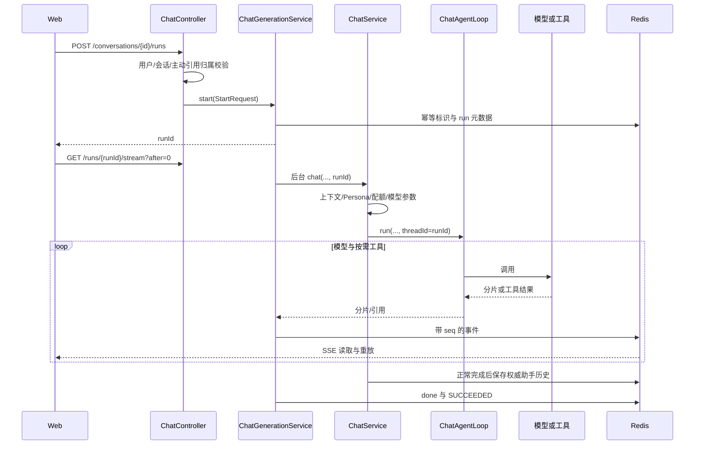

# 一条消息的完整代码路径

基线：`933ff4a1bed8ef0cad1056f9d8a576742ba4eb27`。主线选择“Web 用户主动引用一篇私密日记，发送普通 Flash 聊天消息”。此文是源码走读；本轮没有向真实模型发送该消息。

## 先区分三个 ID

| ID | 表示什么 | 恢复时的作用 |
| --- | --- | --- |
| `conversationId` | 一段会话 | 确认用户归属，读取历史与会话 Persona |
| `runId` | 一次回答任务，可能包含多次模型／工具调用 | 同时作为状态图 threadId；客户端重连和审批续跑复用它 |
| `contextId` | 上下文审计标识 | 关联上下文来源、策略与 Persona／模型元数据，不作为前端续流游标 |



图省略异步标题生成；写入工具审批分支见后文。事件日志与状态图检查点是两种数据，不能相互代替。

## 从点击发送到看到回答

| 步骤 | 真实入口与责任 |
| --- | --- |
| 1. 收集本轮输入 | [useChatStream.send](D:/Code/MoodCopilot/frontend/src/composables/useChatStream.ts:161)：防重复发送、确保会话，保留用户选择的模型、日记／事件引用和图片；随后调用 `sendReply`。 |
| 2. 建立回答任务 | [chatApi.replyStream](D:/Code/MoodCopilot/frontend/src/api/social.ts:123)：生成 `clientRequestId`，POST `/api/chat/conversations/{id}/runs`，Web 明确声明 `approvalsInteractive:true`；把返回的 runId 存入 sessionStorage，然后订阅事件。 |
| 3. 认证与归属校验 | [JwtAuthenticationFilter](D:/Code/MoodCopilot/backend/moodcopilot/src/main/java/com/moodcopilot/security/JwtAuthenticationFilter.java:36) 建立认证上下文；[ChatController.startRun](D:/Code/MoodCopilot/backend/moodcopilot/src/main/java/com/moodcopilot/ai/ChatController.java:73) 校验会话归属，解析消息和引用；[ChatReferenceResolver.resolve](D:/Code/MoodCopilot/backend/moodcopilot/src/main/java/com/moodcopilot/ai/ChatReferenceResolver.java:35) 按用户读取有权限的日记／事件。 |
| 4. 幂等与后台执行 | [ChatGenerationService.start](D:/Code/MoodCopilot/backend/moodcopilot/src/main/java/com/moodcopilot/ai/ChatGenerationService.java:84)：用 `userId + clientRequestId` 的 Redis `setIfAbsent` 领取创建资格；复用已存在 run，否则保存元数据并交给 `aiExecutor`。重复点击若生成不同 clientRequestId，不由这一机制自动合并。 |
| 5. 准备模型输入 | [ChatService.prepareChatRequest](D:/Code/MoodCopilot/backend/moodcopilot/src/main/java/com/moodcopilot/ai/ChatService.java:817)：再次校验会话，确定本地 TaskContext，经 ContextPlanner 组织核心／正式记忆、主动引用及允许的时间线数据；加载全局和会话 Persona、历史与必要的图片描述。 |
| 6. 规划与渲染 | [ContextPlanner](D:/Code/MoodCopilot/backend/moodcopilot/src/main/java/com/moodcopilot/ai/ContextPlanner.java:109) 负责用户隔离、有效资格、来源去重与规划；结构保持为 ContextEnvelope，经 [PromptComposer](D:/Code/MoodCopilot/backend/moodcopilot/src/main/java/com/moodcopilot/ai/PromptComposer.java:40) 和 PromptRenderer 渲染。不要把 RAG 检索函数说成直接拼业务 Prompt。 |
| 7. 配额与模型选择 | [prepareChatExecution](D:/Code/MoodCopilot/backend/moodcopilot/src/main/java/com/moodcopilot/ai/ChatService.java:556)：`false → CHAT_FLASH`，`true → CHAT_PRO`；额度不足抛业务异常，不自动切模型。记录上下文元数据，再由 ChatModelProfiles 提供模型参数。 |
| 8. 用户历史与 Agent | [ChatService.chat](D:/Code/MoodCopilot/backend/moodcopilot/src/main/java/com/moodcopilot/ai/ChatService.java:378)：经统一入口追加 user 历史，构造消息，调用同一套 ChatAgentLoop；Flash／Pro 差异来自 AgentLoopOptions。 |
| 9. 调模型／工具 | [ChatAgentLoop.compileGraph](D:/Code/MoodCopilot/backend/moodcopilot/src/main/java/com/moodcopilot/ai/ChatAgentLoop.java:236)：`agent → tools → agent`，没有待执行工具时结束，受深度限制。`agentAction` 经 DeepSeekClient 发起模型流；工具统一由 ChatToolRegistry 执行和注入认证上下文。 |
| 10. 按需检索 | 当前主入口的 `ragCtx` 初始为空，日记检索由模型按需调用工具，不是每条聊天都做 embedding。例：[DiarySemanticSearchTool](D:/Code/MoodCopilot/backend/moodcopilot/src/main/java/com/moodcopilot/ai/tool/impl/DiarySemanticSearchTool.java:56) 从 ToolExecutionContext 获取用户 ID，再调用 RagMemoryService.searchForTool；结果保持结构化数据，并可产生来源引用。主动引用的日记不等于向量召回。 |
| 11. 保存生成事件 | [ChatGenerationService.consume](D:/Code/MoodCopilot/backend/moodcopilot/src/main/java/com/moodcopilot/ai/ChatGenerationService.java:200) 接收普通／推理分片和工具引用，`writeEvent` 添加 seq 后写入 `chat:run:{runId}:events`；元数据在 `:meta`。配置代码中的 run TTL 为 1 天，不等于永久档案。 |
| 12. SSE 与 UI | [ChatGenerationService.stream](D:/Code/MoodCopilot/backend/moodcopilot/src/main/java/com/moodcopilot/ai/ChatGenerationService.java:291) 默认每 250ms 读取 Redis 事件并按 `after` 筛选；前端 `consumeChatRunStream` 更新游标，分派正文、状态、引用、审批和终态。当前实现读取 Redis List 后过滤，不要说成 Redis Streams。 |
| 13. 保存助手历史 | 正常流完成且未暂停时，[ChatService.addAssistantTurn](D:/Code/MoodCopilot/backend/moodcopilot/src/main/java/com/moodcopilot/ai/ChatService.java:663) 从 AgentLoopOutcome 取正文、推理与工具引用，经 `appendToChatMemory → ChatHistoryStore.append` 保存。生成服务不再写第二份助手历史。 |
| 14. 收尾与后处理 | 生成服务转入 `FINALIZING`，写 done、置 `SUCCEEDED`，再异步安排记忆抽取；前端 `finishSend` 清理流状态并补标注。当前 `scheduleMemoryExtraction` 实际使用 `aiExecutor`，不能把这一聊天后处理说成已走 RabbitMQ。 |

当前聊天权威历史由 [ChatHistoryStore](D:/Code/MoodCopilot/backend/moodcopilot/src/main/java/com/moodcopilot/ai/ChatHistoryStore.java:42) 写入 Redis `chat:msgs:{conversationId}`，通过 Lua 比较并交换防覆盖，写入 TTL 为 7 天。不要未经核实就说聊天历史永久保存在 MySQL。前端 `PUT /history` 是补标注，不能取代服务端正文的权威写入。

## 刷新、审批和失败分支

**刷新不是重发问题。** [resumeActiveRun](D:/Code/MoodCopilot/frontend/src/composables/useChatStream.ts:254) 读取 sessionStorage 中的 runId，查询归属／状态，再从 0 重放来重建页面；同一次连接中断后的重连则用已有 sequence 续接。能恢复的前提包括同一标签页保留的 runId、Redis 事件仍在有效期内，以及原生成仍在运行或已保存结果；不等于支持任意新设备恢复。

**审批是暂停。** ToolsAction 在需要用户确认的工具执行前中断，图状态存入检查点，run 转 `AWAITING_APPROVAL` 并发 `approval_required`；此时不写 done、不落半截助手历史、不启动抽取。POST `/approve` 先原子迁移等待状态，随后用同一 runId 从检查点恢复。第二次审批点击会被状态检查拒绝；每个新写入调用仍要单独批准。

**两种恢复不要混淆。** `chat:run:*` 事件负责页面重放；`langgraph:checkpoint:*` 负责图审批续跑。普通运行中的后端进程崩溃后自动重启生成，不由当前事件重放机制保证。

**模型失败。** Agent 有流空闲超时；异常向生成服务传播，转 FAILED 并写 error 事件。配额错误保留用户可理解的业务消息。工具执行错误可被包装为结构化工具结果，再让模型继续；这与 HTTP 请求失败不是同一层。

**工具重复调用。** 相同 run 内的 `tool_call_id` 有检查点回执保护；不同 ID、不同 run 不自动合并。同 ID 名称或参数冲突会拒绝。工具已经提交副作用、检查点尚未保存时崩溃，仍有重复执行窗口，不能宣称 exactly-once。

本轮的相关证据：ChatGenerationServiceTest 18 项、ChatAgentResilienceTest 16 项等，精确分项以 [evidence-summary.json](./evidence/2026-10-28/evidence-summary.json) 为准；Redis、模型和工具边界等使用受控替身，不是生产故障验证。

## 附：如果面试官问的是 RabbitMQ 的“一条消息”

```text
DiaryController.create
  → DiaryService.create（事务保存日记，返回后事务已结束）
  → Controller 检查 DIARY_FLASH / DIARY_PRO 配额
  → DiaryService.submitAiAnalysisTask（标记 analyzing）
  → AiTaskProducer.submitDiaryAnalysisTask
  → AiTaskService.enqueue（写 MySQL ai_tasks，PENDING_DISPATCH）
  → AiTaskScheduler.dispatch（每轮完成后默认等待 5 秒）
  → AiTaskService.dispatchDueTasks（租约领取、发送、等发布确认）
  → RabbitMQ 分析队列
  → AiTaskConsumer.consumeAnalysis / consume
  → AiTaskService.claimForRun（数据库状态条件更新领取资格）
  → DiaryService.runAiAnalysisSync（模型分析、结果保存、创建后处理任务）
  → markSucceeded → ACK
```

投递失败：`markDispatchFailed → RETRY_WAIT + nextRetryAt → 下轮扫描重投`；达到上限转数据库 `DEAD_LETTER` 并标记日记失败。消费失败：先记录重试／最终失败状态，再 ACK；重投由任务表驱动。`DEAD_LETTER` 状态不代表一定已投递到 RabbitMQ 死信队列。

代码入口：[DiaryController](D:/Code/MoodCopilot/backend/moodcopilot/src/main/java/com/moodcopilot/diary/DiaryController.java:39)、[AiTaskService](D:/Code/MoodCopilot/backend/moodcopilot/src/main/java/com/moodcopilot/ai/mq/AiTaskService.java:83)、[AiTaskConsumer](D:/Code/MoodCopilot/backend/moodcopilot/src/main/java/com/moodcopilot/ai/mq/AiTaskConsumer.java:68)。

边界：日记保存和分析任务 enqueue 不在同一事务，不能称为已经完成原子业务 Outbox；任务创建失败可能出现日记已保存、接口报错。任务状态去重不保证外部 AI 调用严格一次。当前本轮仅跑 AiTaskProducerTest 的 2 项章节 operationKey 用例，没有实际停 RabbitMQ、重启消费者或验证整条投递链路。

## 先练熟这段 60 秒回答

> 网页先创建一个回答任务，服务端检查用户和会话归属，返回 runId；生成在后台继续。ChatService 组织有权限的上下文、Persona 和历史，按用户选的 Flash 或 Pro 参数进入同一套 Agent 状态图。模型按需调用工具，生成分片先写成带序号的 Redis 事件，网页通过 SSE 消费。刷新时重放同一个 run，写入工具要审批时则从图检查点恢复。正常结束后，助手正文由服务端统一保存，前端只补标注。事件重放解决页面恢复，检查点解决图续跑；两者不互相替代。
