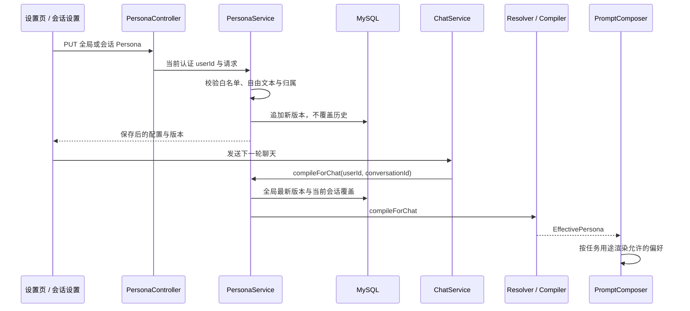

# 一份 Persona 设置的完整代码路径

整理日期：2026-11-16（Asia/Shanghai）。依据当前工作区（含未提交修改），HEAD 为 `3d895f82a2c9af3d4e1e34b5f573708092f2a765`。本篇未保存真实设置或调用预览模型。

主线：用户在全局设置里选择语气与回答方式，再为某个会话覆盖设置，发送消息时由后端解析并注入合规的互动偏好。另看预览与恢复继承的分支。

## 先分清字段和职责

| 名称 | 控制什么 |
| --- | --- |
| `role` | 允许的互动角色，不能改变真实权限 |
| `tone / customTone` | 预设语气标签／自由表达风格，例如“冷静务实” |
| `behaviorFlags / disabledBehaviorFlags` | 结构化回答方式的启用／关闭，例如分步骤、先说结论 |
| `customResponseStyle` | 自由描述答案组织，例如“先给结论，再列三个步骤” |
| `customDescription` | 历史兼容字段，不作为新的 Prompt 输入或新用户入口 |
| `EffectivePersona` | 服务端解析、校验后得到的结构化有效设置 |
| `TaskContext` | 本次任务类型，由本地规则／用户明确指定产生，不负责选模型或授予工具权限 |

Persona 表示“希望 AI 怎么互动”，Memory 表示“有来源的长期事实”。本轮消息里的“简洁一点”保持在当前请求里，不自动创建第三层 Persona。

## 保存到模型调用



前端展示的继承预览不能替代后端实际编译。

| 顺序 | 入口 | 需要看懂什么 |
| --- | --- | --- |
| 1 | [ProfileSettingsModal.savePersona][global-ui]、[authApi][auth-api] | 全局设置提交 role、tone、行为开关、自定义语气和回答方式。 |
| 2 | [ChatPage.saveConversationPersona][chat-ui]、[chatApi.updatePersona][chat-api] | 会话覆盖是另一条接口；取消继承的全局行为应提交 disabledBehaviorFlags。 |
| 3 | [PersonaController][controller] | 全局 `/api/auth/ai-persona`，会话 `/api/chat/conversations/{conversationId}/persona`，userId 来自认证。 |
| 4 | [saveGlobal][global-save]、[saveOverride][override-save] | 校验规范化，校验会话归属，加稳定父行锁分配版本，再 INSERT 新行保留历史。 |
| 5 | [currentOverride][current]、[deleteOverride][reset] | 没有覆盖返回 null；恢复继承追加版本化 reset marker，不能把历史行 DELETE 掉。 |
| 6 | [ChatService.prepareChatRequest][chat]、[compileForChat][compile-chat] | 普通聊天按用户和会话读取两层配置，走不带 Turn 配置的编译入口；兼容重载仍存在不代表产品重新支持 Turn Persona。 |
| 7 | [PersonaResolver.resolve][resolver] | 选择字段来源并保留解析轨迹；会话 role 覆盖全局，tone 空数组与 null 的含义不同，行为开关按作用域合并。 |
| 8 | [PersonaCompiler][compiler]、[PersonaPolicy][policy] | 自定义文本安全过滤、规范化、白名单及哈希，产出 EffectivePersona，不直接生成业务 Prompt。 |
| 9 | [PromptComposer][composer]、[PersonaPromptSupport][support] | 统一组装策略、任务、有效偏好与上下文；自定义回答方式使用独立 response_style 区域，并按任务用途限制。 |
| 10 | [ContextMetadataRecorder][audit] | 审计有效配置哈希、版本、任务与请求／实际模型；元数据失败不应阻断正常回答。 |

## 用具体例子理解覆盖

| 配置 | 结果 |
| --- | --- |
| 全局 tone 为自然清晰，会话 tone 为 null | 继承全局 tone |
| 全局 tone 为自然清晰，会话 tone 为 `[]` | 明确清空会话语气，回到系统默认语气，不继承全局数组 |
| 全局启用某行为，会话 disabled 中包含它 | 会话关闭该行为 |
| 同一作用域同时 enabled 和 disabled | disabled 优先 |
| 会话 GET 返回 null | 当前没有会话覆盖，前端应继续读取并展示全局设置 |
| 会话提供有效 customResponseStyle | Resolver 选会话值，不把全局与会话自由文本拼在一起 |

例如下面表达“这个会话取消全局的某个回答行为”；实际 flag 必须取后端白名单中的值：

```text
全局 behaviorFlags = [某行为]
会话 behaviorFlags = []
会话 disabledBehaviorFlags = [某行为]
```

仅提交会话空 enabled 数组，不一定能移除从全局继承来的行为，所以需要独立 disabled 字段。

## 预览不是普通聊天

[PersonaService.preview][preview] 只使用请求草稿和示例消息，临时编译后直接调用用户指定模型。不读取或写入私人日记、正式记忆、RAG、聊天历史，不创建普通会话或触发聊天后处理。

“沙箱”不等于完全零副作用：当前代码仍扣对应 CHAT_FLASH / CHAT_PRO 配额，并尝试记录模型调用元数据。这与写入用户记忆、历史或创建通知是不同层面的动作。预览按钮也必须尊重 `useReasoning`，不因文本复杂而切模型。

## 安全、输出与故障边界

- 自定义语气／回答方式只能表达非权威偏好，不能授予数据权限、切模型或绕过审批。字符串过滤不是唯一防线，实际工具与用户隔离仍须运行时检查。
- 自由表达字段需要长度限制、规范化和 XML 转义；不能把用户原文直接拼成系统级规则。
- 自定义回答方式仅用于 CHAT、预览及允许自然语言的 EVENT_REVIEW；日记分析、记忆／事件抽取、章节、时间线、报告等结构化任务不注入它，避免破坏输出 Schema。
- `customDescription`、旧 temporary 字段、旧 Turn 重载仍可能在源码中出现；判断实际行为要追普通聊天调用点，不能凭“有字段”认定已启用。
- 会话不归当前用户、白名单／敏感文本校验失败，应拒绝操作；不能悄悄保存一份看似成功但含越权内容的设置。

## 建议断点与自测

按 `saveGlobal / saveOverride` → `latestGlobal / latestOverride` → `PersonaResolver.resolve` → `PersonaCompiler` → `PromptComposer` 走读。记录版本、字段来源、哈希和任务用途，不打印完整私人配置。

- [ ] 能说明 Persona、Memory、TaskContext、CurrentUserRequest 分别是什么。
- [ ] 能解释会话 null、字段 null、tone 空数组三个不同含义。
- [ ] 能找到恢复继承为什么插入一行、版本怎样递增。
- [ ] 能解释“取消某个全局行为”为什么要 disabledBehaviorFlags。
- [ ] 能指出普通聊天没有读取哪几个历史临时字段。
- [ ] 能说明预览隔离了哪些业务，以及仍然记录／消耗什么。

推荐读 [PersonaResolverTest][test-resolve]、[PersonaCompilerTest][test-compile]、[PersonaServiceTest][test-service]、[TaskContextResolverTest][test-task]；本篇未运行测试。

## 60 秒复述

> Persona 有全局与会话两层，保存和恢复继承都追加版本。后端按当前用户读取配置，Resolver 选择各字段来源，Compiler 做规范化、安全处理与哈希，产出结构化 EffectivePersona，再由统一 Prompt 边界按任务用途渲染。它只控制互动方式，不是事实记忆或权限配置，也不改变用户手动选择的模型。预览只用草稿与示例问题，不读取私人资料或创建聊天，但仍有对应配额和调用审计。

[global-ui]: D:/Code/MoodCopilot/frontend/src/components/profile/ProfileSettingsModal.vue:528
[auth-api]: D:/Code/MoodCopilot/frontend/src/api/auth.ts:28
[chat-ui]: D:/Code/MoodCopilot/frontend/src/pages/ChatPage.vue:729
[chat-api]: D:/Code/MoodCopilot/frontend/src/api/social.ts:90
[controller]: D:/Code/MoodCopilot/backend/moodcopilot/src/main/java/com/moodcopilot/ai/PersonaController.java:12
[global-save]: D:/Code/MoodCopilot/backend/moodcopilot/src/main/java/com/moodcopilot/ai/PersonaService.java:121
[override-save]: D:/Code/MoodCopilot/backend/moodcopilot/src/main/java/com/moodcopilot/ai/PersonaService.java:143
[current]: D:/Code/MoodCopilot/backend/moodcopilot/src/main/java/com/moodcopilot/ai/PersonaService.java:136
[reset]: D:/Code/MoodCopilot/backend/moodcopilot/src/main/java/com/moodcopilot/ai/PersonaService.java:176
[chat]: D:/Code/MoodCopilot/backend/moodcopilot/src/main/java/com/moodcopilot/ai/ChatService.java:846
[compile-chat]: D:/Code/MoodCopilot/backend/moodcopilot/src/main/java/com/moodcopilot/ai/PersonaService.java:86
[resolver]: D:/Code/MoodCopilot/backend/moodcopilot/src/main/java/com/moodcopilot/ai/PersonaResolver.java:23
[compiler]: D:/Code/MoodCopilot/backend/moodcopilot/src/main/java/com/moodcopilot/ai/PersonaCompiler.java:17
[policy]: D:/Code/MoodCopilot/backend/moodcopilot/src/main/java/com/moodcopilot/ai/PersonaPolicy.java:6
[composer]: D:/Code/MoodCopilot/backend/moodcopilot/src/main/java/com/moodcopilot/ai/PromptComposer.java:11
[support]: D:/Code/MoodCopilot/backend/moodcopilot/src/main/java/com/moodcopilot/ai/PersonaPromptSupport.java:16
[audit]: D:/Code/MoodCopilot/backend/moodcopilot/src/main/java/com/moodcopilot/ai/ContextMetadataRecorder.java:21
[preview]: D:/Code/MoodCopilot/backend/moodcopilot/src/main/java/com/moodcopilot/ai/PersonaService.java:197
[test-resolve]: D:/Code/MoodCopilot/backend/moodcopilot/src/test/java/com/moodcopilot/ai/PersonaResolverTest.java:13
[test-compile]: D:/Code/MoodCopilot/backend/moodcopilot/src/test/java/com/moodcopilot/ai/PersonaCompilerTest.java:12
[test-service]: D:/Code/MoodCopilot/backend/moodcopilot/src/test/java/com/moodcopilot/ai/PersonaServiceTest.java:24
[test-task]: D:/Code/MoodCopilot/backend/moodcopilot/src/test/java/com/moodcopilot/ai/TaskContextResolverTest.java:9
