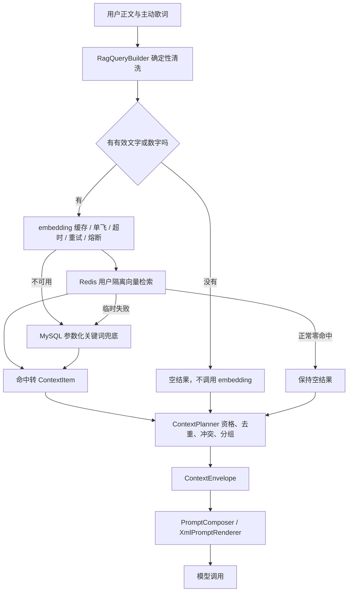

# 一次检索与上下文的完整代码路径

整理日期：2026-11-16（Asia/Shanghai）。依据当前工作区（含未提交修改），HEAD 为 `3d895f82a2c9af3d4e1e34b5f573708092f2a765`。本篇未发送 embedding／模型请求，未测召回率、耗时或生产故障恢复。

主线：分析日记时，如何用用户原文检索以往记录，再让合规的参考资料进入本次模型输入。聊天工具检索作为另一条分支单独说明，不能把它们说成同一种调用时机。

## 先区分“查到”与“可以给模型看”

| 对象 | 责任 |
| --- | --- |
| `RagQuery` | 用户、用途、查询文本、来源类型、时间范围和 topK |
| `RagHit / RagSearchResult` | 原始命中及检索模式，例如向量或关键词兜底 |
| `ContextItem + ContextSource` | 内容与结构化来源、作者、用户、事件时间、信任等级 |
| `ContextPlanner` | 资格过滤、分组、去重、冲突标记与上下文规划 |
| `ContextEnvelope` | 平级的核心记忆、短期状态、主动引用、检索、时间线、工具结果等容器 |
| `PromptComposer / PromptRenderer` | 在统一边界将结构化上下文表达为模型输入；XML 是输出格式 |

原始向量命中不是可信事实。一个向量即使还存在，也不能使已失效或无权访问的正式记录重新进入上下文。

## 主线流程



检索为空不等于本次完全没有上下文；Planner 仍可能读取用户有效正式记忆。模型选择继续由 `useReasoning` 决定。

| 顺序 | 入口 | 应该看什么 |
| --- | --- | --- |
| 1 | [AiAnalysisService.analyzeWithMemorySignals][analysis] | 构建 `diary_analysis` 查询，只检索指定来源，topK 是候选数量请求，不是最终 Prompt 条目数。 |
| 2 | [RagQueryBuilder.diaryQueryText][query] | 只使用脱敏后的正文和 `userLyric`，规范 Unicode、控制字符与空白并限长；不把 AI 摘要、反馈、情绪或图片描述放进事实查询。 |
| 3 | [searchDetailed][search] | 验证 userId、来源白名单与有效文本；空白或纯符号直接空结果。embedding 失败才进入降级分支。 |
| 4 | [embed][embed]、[embedUncached][embed-raw] | 有界缓存、同查询并发单飞、连接／读取超时、有限重试与抖动、维度和数值校验，以及熔断／半开探测。单飞是共享同一次请求，不是把不同用户数据混在一起。 |
| 5 | [searchDetailed][search] | Redis 检索带用户、来源、可选时间条件；兼容 RESP2／RESP3 解析；评分是 COSINE distance，越小越接近，不能按“越大越好”解释。 |
| 6 | [filterQualityHits][quality]、[lexicalFallback][fallback] | 过滤差距过大的向量结果；Redis／embedding 不可用时采用带用户与资格条件的 SQL 查询。正常返回空列表直接保留向量零命中，不误触发兜底。 |
| 7 | [retrieveContextItemsFromHits][items] | 日记来源核对数据库归属和删除状态，内容脱敏，补结构化来源；图片描述标为系统生成且 UNTRUSTED，音乐标为用户提供的歌词信息。 |
| 8 | [ContextPlanner.planEnvelopeWithReferencePurpose][planner] | 读取当前有效正式记忆，按核心、短期状态、普通正式记忆等分类；主动引用单独承载，冲突事实保留分支。 |
| 9 | [filterRetrieved][filter]、[isAuthorizedSource][auth] | 过滤缺来源、用户不匹配、助手来源和失效正式版本；正式记忆再核验数据库有效性，再执行来源／内容去重。 |
| 10 | [PromptComposer][composer]、[XmlPromptRenderer][renderer] | 在渲染边界表达数据、处理转义和完整条目预算；参考内容不拥有系统指令权限。 |
| 11 | [ContextMetadataRecorder][audit] | 记录 contextId、来源／策略／模板／Persona 与模型等元数据；失败不能阻断模型，不保存完整隐私 Prompt 作为补救。 |

## 用一小段代码读懂职责

```java
List<ContextItem> retrieved = ragMemoryService.retrieveContextItems(ragQuery);
ContextPlanner.ContextPlan plan = contextPlanner.planEnvelope(
    userId, null, "", List.of(), retrieved, ContextPurpose.DIARY_ANALYSIS);
ContextEnvelope envelope = plan.envelope();
```

第一句查候选；第二句把候选和当前可用资料统一规划；第三句取得结构化结果。这几句没有要求 RAG 服务自己拼业务 Prompt。

`contextId` 关联本次上下文审计；不是日记 ID，不是会话 ID，也不是 SSE 的恢复游标。

## 聊天检索与索引写入的两条支线

**聊天：** [DiarySemanticSearchTool.execute][tool] 从 `ToolExecutionContext` 取得用户 ID，再调用 [searchForTool][tool-search]。检索由 Agent 按需发起，结果为结构化工具数据并产生引用；不是每条聊天都先 embedding，也不是用户主动引用日记就一定经过向量召回。聊天主动引用走 `ChatReferenceResolver`，见[消息篇](./message-code-path.md)。

**正式记忆索引：** [indexUserProfile][profile] 按 `rag:profile:{userId}:{memoryId}` 管理记录，使用锁、快照和内容／有效状态比较进行增量向量化，清当前用户失效孤儿键。不能说成每次先删用户全部索引再重建；索引同步也不替代数据库版本链。

**任务差异：** 画像抽取复用主分析信号时不必再发起一次独立检索；缺失信号的兼容抽取流程才有自己的查询。不要把旧兼容路径描述成每篇日记必经路径。

## 排查顺序与自测

“为什么 AI 没找到那篇日记”按层排查：查询是否有效 → 是否建索引 → 来源／时间过滤 → 向量距离 → 是否故障降级 → 来源资格 → Planner 去重／预算。查到候选和最终注入数量可能不同。

推荐阅读 [RagQueryBuilderTest][test-query]、[RagMemoryServiceTest][test-rag]、[ContextPlannerTest][test-plan]、[XmlPromptRendererTest][test-xml]；本篇未运行它们。空查询、零命中、embedding 故障、Redis 故障、RESP 两种协议、用户隔离和 XML 转义要分别验证。

- [ ] 为什么 AI 自己生成的摘要不能再变成事实查询来源？
- [ ] 正常零命中与检索故障为什么不能共用“回退 SQL”判断？
- [ ] 检索命中属于当前用户，为什么仍然需要资格过滤？
- [ ] 向量、ContextItem、ContextEnvelope、XML 分别处于哪一层？
- [ ] 冲突事实为什么不能在规划时擅自揉成一个结论？
- [ ] 编程任务为什么不应自动塞入全部私人历史？检查 Planner 的 TaskContext 分支。

## 60 秒复述

> RAG 只检索候选。日记查询来自用户正文和主动歌词，先做确定性清洗，空查询不调用 embedding。向量检索按用户与来源过滤，只有服务不可用时才走参数化关键词兜底。命中转成带来源与信任等级的 ContextItem，再经 Planner 做资格、去重、冲突和预算规划，保持为 ContextEnvelope，最后在统一边界渲染。正常零命中、用户主动引用和模型按需工具检索是不同情况。

[analysis]: D:/Code/MoodCopilot/backend/moodcopilot/src/main/java/com/moodcopilot/ai/AiAnalysisService.java:147
[query]: D:/Code/MoodCopilot/backend/moodcopilot/src/main/java/com/moodcopilot/ai/RagQueryBuilder.java:18
[search]: D:/Code/MoodCopilot/backend/moodcopilot/src/main/java/com/moodcopilot/ai/RagMemoryService.java:908
[embed]: D:/Code/MoodCopilot/backend/moodcopilot/src/main/java/com/moodcopilot/ai/RagMemoryService.java:260
[embed-raw]: D:/Code/MoodCopilot/backend/moodcopilot/src/main/java/com/moodcopilot/ai/RagMemoryService.java:299
[quality]: D:/Code/MoodCopilot/backend/moodcopilot/src/main/java/com/moodcopilot/ai/RagMemoryService.java:1035
[fallback]: D:/Code/MoodCopilot/backend/moodcopilot/src/main/java/com/moodcopilot/ai/RagMemoryService.java:1054
[items]: D:/Code/MoodCopilot/backend/moodcopilot/src/main/java/com/moodcopilot/ai/RagMemoryService.java:1186
[planner]: D:/Code/MoodCopilot/backend/moodcopilot/src/main/java/com/moodcopilot/ai/ContextPlanner.java:113
[filter]: D:/Code/MoodCopilot/backend/moodcopilot/src/main/java/com/moodcopilot/ai/ContextPlanner.java:234
[auth]: D:/Code/MoodCopilot/backend/moodcopilot/src/main/java/com/moodcopilot/ai/ContextPlanner.java:288
[composer]: D:/Code/MoodCopilot/backend/moodcopilot/src/main/java/com/moodcopilot/ai/PromptComposer.java:11
[renderer]: D:/Code/MoodCopilot/backend/moodcopilot/src/main/java/com/moodcopilot/ai/XmlPromptRenderer.java:9
[audit]: D:/Code/MoodCopilot/backend/moodcopilot/src/main/java/com/moodcopilot/ai/ContextMetadataRecorder.java:21
[tool]: D:/Code/MoodCopilot/backend/moodcopilot/src/main/java/com/moodcopilot/ai/tool/impl/DiarySemanticSearchTool.java:56
[tool-search]: D:/Code/MoodCopilot/backend/moodcopilot/src/main/java/com/moodcopilot/ai/RagMemoryService.java:1264
[profile]: D:/Code/MoodCopilot/backend/moodcopilot/src/main/java/com/moodcopilot/ai/RagMemoryService.java:540
[test-query]: D:/Code/MoodCopilot/backend/moodcopilot/src/test/java/com/moodcopilot/ai/RagQueryBuilderTest.java:10
[test-rag]: D:/Code/MoodCopilot/backend/moodcopilot/src/test/java/com/moodcopilot/ai/RagMemoryServiceTest.java:24
[test-plan]: D:/Code/MoodCopilot/backend/moodcopilot/src/test/java/com/moodcopilot/ai/ContextPlannerTest.java:13
[test-xml]: D:/Code/MoodCopilot/backend/moodcopilot/src/test/java/com/moodcopilot/ai/XmlPromptRendererTest.java:11
