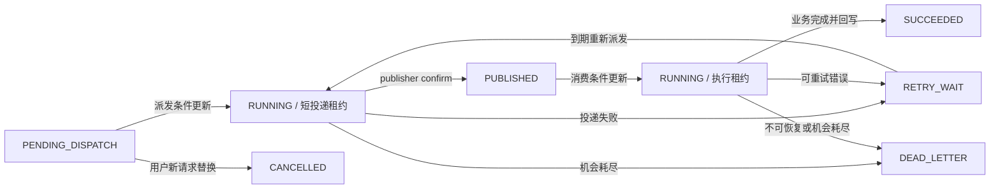

# 一条后台任务的完整代码路径

整理日期：2026-11-16（Asia/Shanghai）。依据当前工作区（含未提交修改），HEAD 为 `3d895f82a2c9af3d4e1e34b5f573708092f2a765`。本篇只走读源码，未启动 RabbitMQ 或进行故障注入。

主线：一篇已保存的日记需要 AI 分析，如何从“待投递”走到“成功”，以及投递失败、消费失败和进程退出时怎样处理。日记的业务细节见[日记路径](./diary-code-path.md)。

## 先把四个“消息”分开

| 对象 | 解决的问题 |
| --- | --- |
| `AiTaskEntity` / MySQL `ai_tasks` | 任务状态、尝试次数、错误、租约、重试时间的持久化 |
| `AiTaskMessage` / RabbitMQ 消息 | 把任务交给消费者，携带 `taskId` 等定位信息 |
| `DiaryAnalysisCompletedEvent` / Spring 应用事件 | 当前进程里的事件通知，不等于 RabbitMQ 持久化消息 |
| 聊天 run 的 SSE 事件 | 浏览器读取、重放生成结果，与这条后台任务链路不同 |

`aggregateId` 是业务对象（例如日记）的 ID；`taskId` 是本次任务的 ID；`parentTaskId` 关联前置任务；`idempotencyKey` 决定入任务表时是否复用已有任务。它们不能互相替代。

## 正常路径与状态变化



同一个 `RUNNING` 被投递租约与执行租约共用；要结合 `startedAt / leaseOwner / leaseUntil` 阅读，不能只看状态字符串。`CANCELLED` 的入口还支持取消 `PUBLISHED / RETRY_WAIT` 的日记主任务，图中只画一个箭头。

| 顺序 | 入口 | 负责什么 |
| --- | --- | --- |
| 1 | [AiTaskProducer.submitDiaryAnalysisTask][producer] | 按日记输入指纹、用户所选模型和本次请求 UUID 形成 operationKey；用户再次提交产生新请求，MQ 重投仍使用同 taskId。 |
| 2 | [AiTaskService.enqueue][enqueue] | 查相同幂等键；新任务记录 userId、类型、aggregateId、payload、最大尝试次数，写 `PENDING_DISPATCH`。此刻还没发到 RabbitMQ。 |
| 3 | [AiTaskScheduler.dispatch][schedule] | 默认每轮完成后等待 5 秒，扫描到期任务；恢复扫描默认 30 秒。配置可以覆盖默认值。 |
| 4 | [dispatchDueTasks][dispatch]、[claimForDispatch][dispatch-claim] | 批量读取后仍需带条件的 UPDATE 领取短租约，避免两个派发器只靠先 SELECT 就重复取得资格。 |
| 5 | [dispatchDueTasks][dispatch] | 发送消息，等待最多 10 秒的 publisher confirm；确认后按 owner 与状态条件回写 `PUBLISHED`。 |
| 6 | [AiTaskConsumer.consume][consume]、[claimForRun][claim] | 从消息定位数据库任务，条件更新成执行中的 `RUNNING`、记录租约和增加 attempts；拿不到资格时不直接执行业务。 |
| 7 | [AiTaskConsumer.consume][consume] | 根据数据库里的任务类型，调用日记分析、章节整理、记忆整理或通用后处理；不是直接相信消息 body 决定全部业务。 |
| 8 | [markSucceeded][success] | 只有匹配当前 `RUNNING` 和 leaseOwner 才写 `SUCCEEDED`，清租约并记完成时间，之后消费者 ACK。 |

## 两个确认不是一回事

```java
CorrelationData.Confirm confirm = correlation.getFuture().get(10, TimeUnit.SECONDS);
```

这一句等待 **RabbitMQ 的发布确认**，不等待模型分析。确认还必须结合交换机／队列路由配置理解，不能单凭这个 ACK 宣称业务一定执行了。

```java
taskService.markSucceeded(task.getTaskId(), task.getLeaseOwner());
channel.basicAck(tag, false);
```

这里的 `basicAck` 是**消费者告诉 broker 这次投递已处理**。失败路径也可能 ACK，因为重试计划已经写进数据库，后续由调度器重新投递。

## 最值得细读的异常分支

| 情况 | 实际处理 | 阅读入口 |
| --- | --- | --- |
| 消息比发布状态回写更早到达 | 任务还在短投递租约中，消费者 NACK 并 requeue，避免把唯一消息当重复 ACK 掉 | [consume][consume]、[isDispatching][dispatching] |
| 重复投递或已有执行者 | 条件领取失败；非投递中状态按重复消息 ACK，不再执行业务 | [claimForRun][claim] |
| broker 断开／发布确认失败 | 写 `RETRY_WAIT + nextRetryAt`，增加投递失败计数；达到上限 `DEAD_LETTER` | [markDispatchFailed][dispatch-fail] |
| 模型或后处理抛出可重试异常 | 先写任务重试状态，再 ACK，按退避时间重投 | [markFailed][fail]、[consume][consume] |
| 无法解析的参数等不可恢复异常 | 消费者分类后写终止失败状态；不是无限重试 | [isUnrecoverable][fatal] |
| 进程退出、租约过期 | 区分投递租约与执行租约，写恢复／终止状态，避免永久 RUNNING | [recoverExpiredTasks][recover]、[markLeaseExpired][lease] |
| 主日记任务最终失败 | 更新日记失败状态，且不覆盖用户已关闭的 `skipped_user` | [markRelatedDiaryFailed][diary-fail] |
| 用户关闭或提交新分析 | 取消待执行／已投递／等待重试的旧任务；已经运行的任务需要业务落库校验保护 | [cancelPendingDiaryAnalysisTasks][cancel] |

## 为什么不是“严格只执行一次”

带条件 UPDATE 解决的是正常竞争下“谁有资格执行、谁能回写”。它不能把远程模型调用、数据库提交和 broker ACK 变成一个原子动作。

例如：外部调用成功后进程退出、尚未写 SUCCEEDED，任务恢复可能再次调用模型。租约没有在所有外部副作用边界消除这个窗口，不能写“AI 严格调用一次”。同样，数据库里的 `DEAD_LETTER` 是任务状态，不意味着当前路径已经把消息发送进某个 RabbitMQ DLQ。

日记保存与创建主分析任务分两段提交；任务表是持久化重试与恢复机制，不能据此把整个流程称为原子业务 Outbox。后处理子任务使用类型与分析版本的幂等键，主任务的新用户请求使用 UUID，二者目的也不同。

## 断点、实验与自测

断点顺序：`enqueue` 看幂等键 → `claimForDispatch` 看 UPDATE 影响行数 → 发布确认 → `claimForRun` 看 attempts → `markFailed / markSucceeded` 看 owner 条件 → ACK。

推荐阅读 [DispatchRecoveryTest][test-recovery]、[DiaryTaskInputTest][test-input]、[AiTaskProducerTest][test-producer]。本篇未执行它们。真实故障练习只在隔离测试环境进行，先用受控替身模拟发布失败和重复消息，不停生产队列。

- [ ] 能分别解释发布确认、业务完成、消费 ACK。
- [ ] 能指出两类租约为什么都叫 RUNNING，以及怎样区分。
- [ ] 能画出重复消息为什么通常不会再次执行业务。
- [ ] 能解释消费失败为什么可能 ACK，以及重试由谁发起。
- [ ] 能说出当前 exactly-once 和 Outbox 保证的边界。

## 60 秒复述

> 后台任务先写入 MySQL，调度器通过状态条件更新领取投递租约，再向 RabbitMQ 发送并等待发布确认。消费者拿 taskId 再领取执行资格，成功或失败状态落库之后 ACK。可重试失败由数据库的 nextRetryAt 驱动重新投递，过期租约由恢复扫描处理。任务表和条件更新提供可观察状态与防竞争，但外部调用与回写之间仍有窗口，不能保证所有副作用只发生一次。

[producer]: D:/Code/MoodCopilot/backend/moodcopilot/src/main/java/com/moodcopilot/ai/mq/AiTaskProducer.java:25
[enqueue]: D:/Code/MoodCopilot/backend/moodcopilot/src/main/java/com/moodcopilot/ai/mq/AiTaskService.java:45
[schedule]: D:/Code/MoodCopilot/backend/moodcopilot/src/main/java/com/moodcopilot/ai/mq/AiTaskScheduler.java:15
[dispatch]: D:/Code/MoodCopilot/backend/moodcopilot/src/main/java/com/moodcopilot/ai/mq/AiTaskService.java:83
[dispatch-claim]: D:/Code/MoodCopilot/backend/moodcopilot/src/main/java/com/moodcopilot/ai/mq/AiTaskService.java:343
[consume]: D:/Code/MoodCopilot/backend/moodcopilot/src/main/java/com/moodcopilot/ai/mq/AiTaskConsumer.java:69
[claim]: D:/Code/MoodCopilot/backend/moodcopilot/src/main/java/com/moodcopilot/ai/mq/AiTaskService.java:127
[success]: D:/Code/MoodCopilot/backend/moodcopilot/src/main/java/com/moodcopilot/ai/mq/AiTaskService.java:149
[dispatching]: D:/Code/MoodCopilot/backend/moodcopilot/src/main/java/com/moodcopilot/ai/mq/AiTaskService.java:327
[dispatch-fail]: D:/Code/MoodCopilot/backend/moodcopilot/src/main/java/com/moodcopilot/ai/mq/AiTaskService.java:217
[fail]: D:/Code/MoodCopilot/backend/moodcopilot/src/main/java/com/moodcopilot/ai/mq/AiTaskService.java:181
[fatal]: D:/Code/MoodCopilot/backend/moodcopilot/src/main/java/com/moodcopilot/ai/mq/AiTaskConsumer.java:155
[recover]: D:/Code/MoodCopilot/backend/moodcopilot/src/main/java/com/moodcopilot/ai/mq/AiTaskService.java:250
[lease]: D:/Code/MoodCopilot/backend/moodcopilot/src/main/java/com/moodcopilot/ai/mq/AiTaskService.java:270
[diary-fail]: D:/Code/MoodCopilot/backend/moodcopilot/src/main/java/com/moodcopilot/ai/mq/AiTaskService.java:303
[cancel]: D:/Code/MoodCopilot/backend/moodcopilot/src/main/java/com/moodcopilot/ai/mq/AiTaskService.java:355
[test-recovery]: D:/Code/MoodCopilot/backend/moodcopilot/src/test/java/com/moodcopilot/ai/mq/DispatchRecoveryTest.java:17
[test-input]: D:/Code/MoodCopilot/backend/moodcopilot/src/test/java/com/moodcopilot/ai/mq/DiaryTaskInputTest.java:12
[test-producer]: D:/Code/MoodCopilot/backend/moodcopilot/src/test/java/com/moodcopilot/ai/mq/AiTaskProducerTest.java:19
